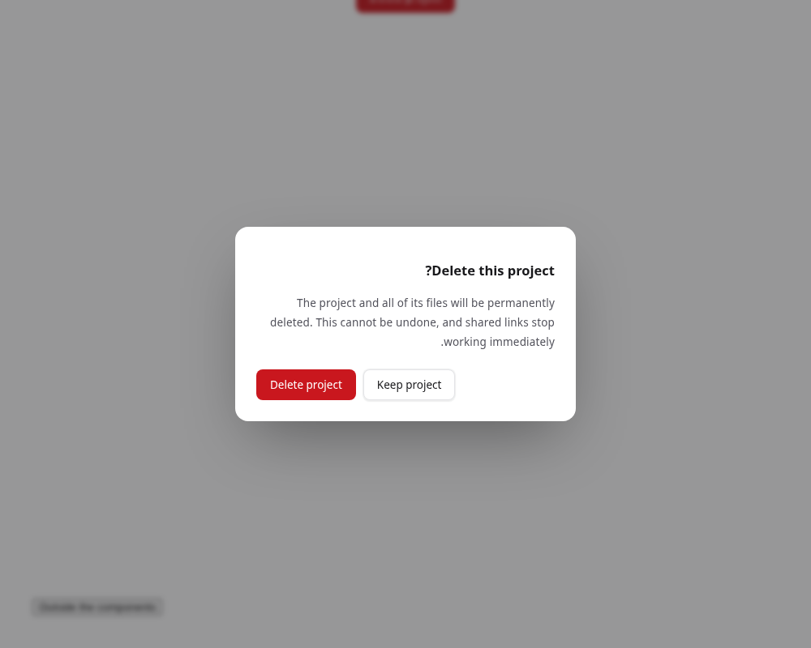
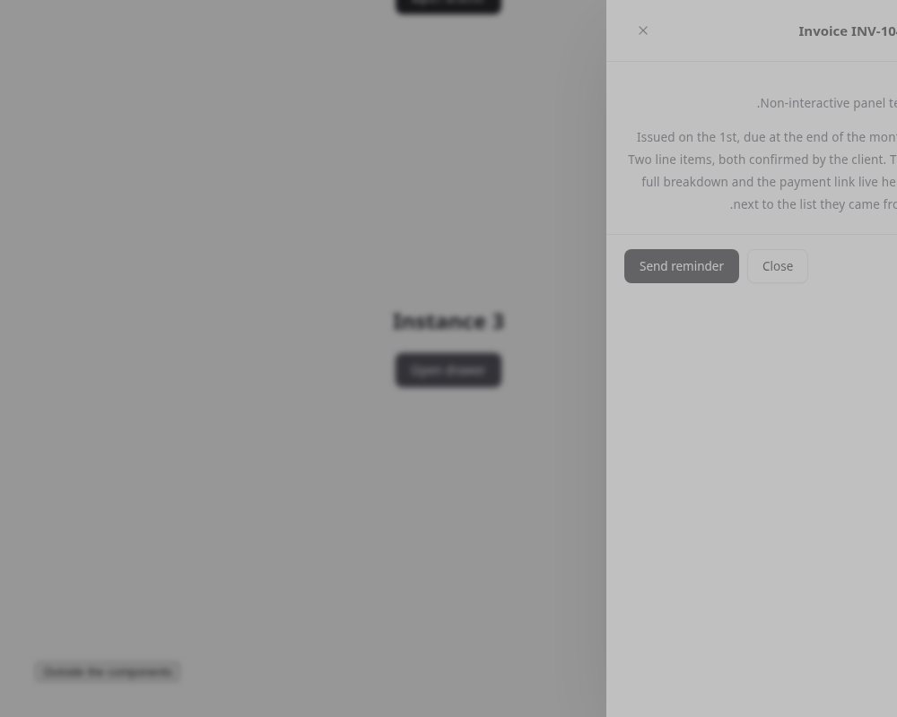
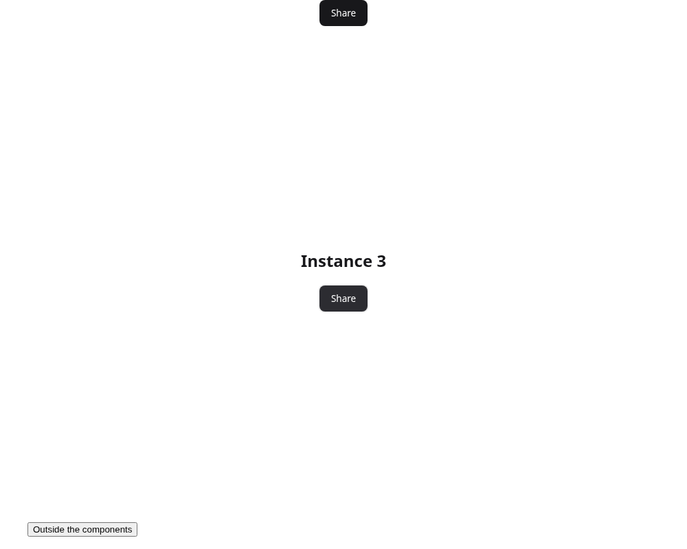

# Overlay instance safety — PR #24

Latest main includes merged PR #23. Three parts were selected by the requested JS-failure priority: Alert Dialog, Drawer, Popover. Modal already passed both JS checks; dropdown-menu maps to the repository slug dropdown, which also passed those checks. They were skipped; no claim is made that the skipped parts have a complete runtime accessibility pattern.

Mold **94 / 164 → 97 / 164**, UI **61 / 121 → 64 / 121**, Lab **33 / 43** unchanged. All three selected parts now pass every static check. Status stays **Beta** for all three. token-values remains **0**. No token, moldVersion or checker rule changes.

| Check | Before findings | After findings |
|---|---:|---:|
| js-single-instance | 24 | 19 |
| js-global-bindings | 57 | 52 |

## Implementation

- Each file is an IIFE with querySelectorAll root initialization and data-kata-ready guard. IDs are generated without collisions and existing IDs are retained. Trigger/panel control relationships are linked at initialization. Existing classes and data attributes remain.
- Native dialog roots use real showModal/close, native modal isolation plus explicit Tab/Shift+Tab cycling, Escape, close buttons and opener focus restoration. Alert Dialog does not close on backdrop clicks; Drawer does. Native modal dialogs do not install focusout dismissal. Cancellation is suppressed while composing. No CSS end event is needed to close native dialogs.
- Alert Dialog keeps backdrop dismissal blocked and uses native Escape cancel → close. The earlier request to dismiss it via backdrop was corrected. Initial focus prefers the marked Cancel action, then a non-primary button, then the dialog body. Cancelling is not a destructive action. The description/usage/accessibility text now states this; no data deletion implementation is claimed.
- Popover is a non-modal dialog, not a menu. Escape returns focus; Tab/focusout with an external non-null target and outside clicks close without taking focus from the destination. Closed content becomes inert immediately and hidden after exit. Zero duration completes immediately; end/cancel handlers and computed duration + delay + 50ms fallback handle cancellation. Reopening clears stale timeouts.
- Preview/examples were checked for fixed id, for and aria-controls: none remain in the three samples. Popover starts hidden/inert, and its haspopup value is dialog. Accessibility text describes only implemented behavior; statuses are unchanged.

## Browser verification

The tests pages each contain three instances, the third dir=rtl, and two copies of the same script. A fourth instance with application IDs is appended and initialized on a subsequent script load. Three motion settings are exercised: normal/light at multiplier1, zero/dark, and OS reduce/light with inline multiplier2. This is nine page cases, each exercising all three original instances.

| Part | Case | Three independent | Double load | RTL | IDs | Focus / Esc / outside |
|---|---|---|---|---|---|
| alert-dialog | normal | pass | pass | pass | unique / existing retained | pass |
| alert-dialog | zero | pass | pass | pass | unique / existing retained | pass |
| alert-dialog | reduce | pass | pass | pass | unique / existing retained | pass |
| drawer | normal | pass | pass | pass | unique / existing retained | pass |
| drawer | zero | pass | pass | pass | unique / existing retained | pass |
| drawer | reduce | pass | pass | pass | unique / existing retained | pass |
| popover | normal | pass | pass | pass | unique / existing retained | pass |
| popover | zero | pass | pass | pass | unique / existing retained | pass |
| popover | reduce | pass | pass | pass | unique / existing retained | pass |

Native dialogs verify forward/backward focus wrap, Escape focus return, and close controls. Alert background clicks keep it open; Drawer background clicks close it. Null focusout/window blur and text clicks keep all four components open. Internal Tab is covered. Alert native cancel is delivered and an application can prevent it. Autofocus fallback is checked with the destructive button first and with only a destructive button remaining. Popover verifies real Tab departure, outside focus preservation, and a paused closing transition that must complete through its timeout. Synthetic composition events and keyCode229 are checked, including composition state reset when closing and reopening without a compositionend event. No page or console errors occurred.

## Remaining JS failures

| Target | Failed checks |
|---|---|
| components/carousel | js-single-instance, js-global-bindings |
| components/color-picker | js-single-instance, js-global-bindings |
| components/command | js-single-instance, js-global-bindings |
| components/context-menu | js-single-instance, js-global-bindings |
| components/data-table | js-single-instance, js-global-bindings |
| components/date-picker | js-single-instance, js-global-bindings |
| components/file-upload | js-single-instance, js-global-bindings |
| components/follow-frame | js-single-instance, js-global-bindings |
| components/input-otp | js-global-bindings |
| components/reorder | js-single-instance, js-global-bindings |
| components/split-panel | js-single-instance, js-global-bindings |
| components/tag-input | js-single-instance, js-global-bindings |
| blocks/pricing | js-single-instance, js-global-bindings |
| blocks/site-header | js-single-instance, js-global-bindings |
| blocks/use-cases | js-global-bindings |

Next priority is Context Menu, Command and Date Picker (Tabs/Tooltip already pass these JS checks).

## Commands and limits

- node --check for all three scripts: pass.
- check.py: 97/164, expected exit1 for the existing 67 failed targets. No selected target has a failed check.
- unittest, warning-as-error build, ratchet, template probe and mold distribution verification: pass. Baseline / ROADMAP and regenerated audit surfaces updated.
- Browser: python3 -m tools.verify_overlay_instances. The same verification is included as a unittest when Playwright/Chromium are available; otherwise it is explicitly skipped.
- Real Japanese IME and screen readers are **not verified**. Synthetic composition guards do not substitute for those tests. Firefox/Safari, mobile touch, zoom, complex consumer forms and viewport collision placement are not verified. This is not a Stable promotion or a whole-library accessibility claim.

## Corrected Alert policy and null focusout

Alert Dialog backdrop clicks do not dismiss. Esc uses native cancel/close without application-side interception, and a consumer can prevent cancel. The sample marks Cancel with data-autofocus to avoid initial focus on a destructive operation. Native Alert/Drawer focusout-dismiss listeners are removed. Popover and Combobox ignore null relatedTarget and retain outside-click dismissal.

Drawer before PR #24 (main deb88d2) used direct dialog.close() and only a kdrawer-in entry keyframe; no exit animation existed. That behavior is retained. At multipliers 1/0 and OS reduce, the closed drawer loses open and becomes explicitly inert; opening clears inert.

The results JSON now includes 9 overlay cases plus 3 Combobox settings with triple instances. Real IME and screen readers remain unverified.
