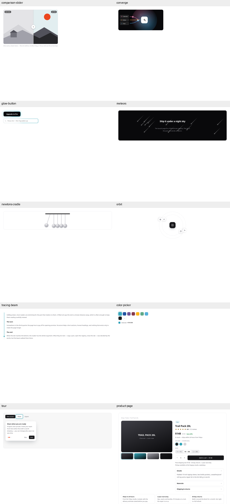
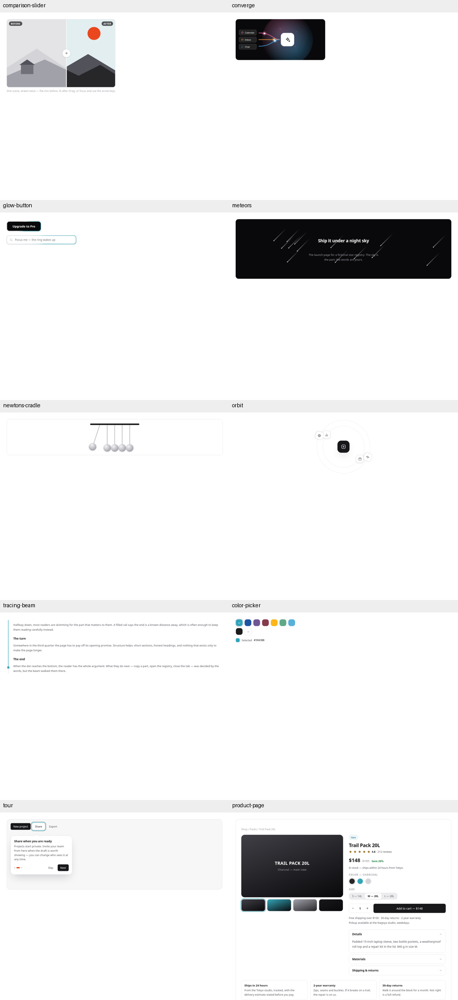
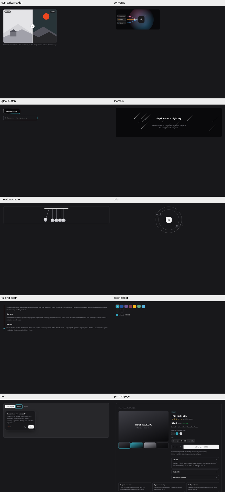
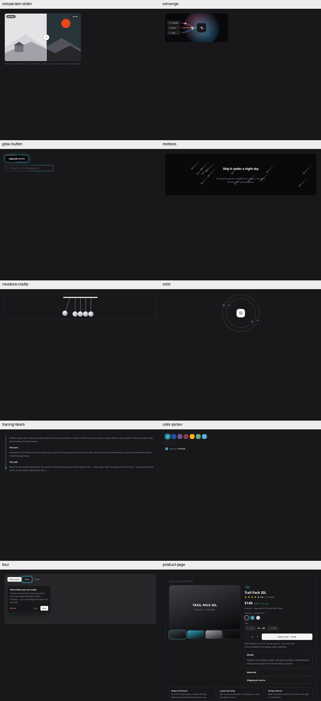

# PR #19 visual regression corrections

Baseline is 9efb97d (before PR #19); initial19 is 0a486dd; restored is this follow-up.

## Lab shadow policy

Glow geometry is part of the effect; only its color must come from the mold.

Offsets/blur/spread are restored for the seven actual Lab targets. Fixed palette tokens replace raw shadow paint: white uses zinc-50; the old neutral shadow hue uses zinc-900. Opacity is preserved with color-mix. Theme-changing --k-ink is not used for those fixed colors. Existing token-only glows preserve their exact pixels.

| Target | Category | Shadow before PR #19 | Restored shadow |
|---|---|---|---|
| components/comparison-slider | Motion | `0 0 0 1px rgba(24,24,27,.25)` | `0 0 0 1px color-mix(in srgb,var(--k-zinc-900) 25%,transparent)` |
| components/comparison-slider | Motion | `0 2px 10px rgba(16,24,40,.3)` | `0 2px 10px color-mix(in srgb,var(--k-zinc-900) 30%,transparent)` |
| components/converge | Motion | `0 0 46px color-mix(in srgb,var(--k-accent) 45%,transparent)` | `0 0 46px color-mix(in srgb,var(--k-accent) 45%,transparent)` |
| components/glow-button | Motion | `0 0 26px -6px var(--k-accent)` | `0 0 26px -6px var(--k-accent)` |
| components/glow-button | Motion | `0 0 18px -4px var(--k-accent-bg)` | `0 0 18px -4px var(--k-accent-bg)` |
| components/meteors | Motion | `0 0 10px 2px rgba(255,255,255,.3)` | `0 0 10px 2px color-mix(in srgb,var(--k-zinc-50) 30%,transparent)` |
| components/newtons-cradle | KATAYABURI | `0 3px 7px rgba(16,24,40,.25)` | `0 3px 7px color-mix(in srgb,var(--k-zinc-900) 25%,transparent)` |
| components/orbit | Motion | `0 12px 26px -10px rgba(16,24,40,.4)` | `0 12px 26px -10px color-mix(in srgb,var(--k-zinc-900) 40%,transparent)` |
| components/orbit | Motion | `0 4px 12px rgba(16,24,40,.1)` | `0 4px 12px color-mix(in srgb,var(--k-zinc-900) 10%,transparent)` |
| components/tracing-beam | Motion | `0 0 0 4px var(--k-accent-bg)` | `0 0 0 4px var(--k-accent-bg)` |

Glow Button is Motion, so no UI-only --k-glow token is needed. Glass Panel and Torn Ticket are Display & Media (UI), so their UI elevation remains unchanged. Component categories were not changed to obtain passes.

## Rule effect

| Scenario | Passing targets |
|---|---:|
| Initial PR #19 | 53 / 164 |
| Rule only, before restoring geometry | 53 / 164 |
| Restored sources under old rules (counterfactual) | 52 / 164 |
| Restored sources under corrected rules | 53 / 164 |

The net score gain is zero. Under the same restored source, one target (Tracing Beam) changes from fail to pass; ten Lab shadow-geometry findings are correctly removed. Other Lab failures (duration, literal non-shadow colors, etc.) remain. This distinction prevents attributing UI elevation normalization to genuine Lab fixes.

## Rings

- Product checked swatch: --k-ring-selected (2px ink). Keyboard focus on its colored surface: --k-ring-offset.
- Color Picker selected swatch and Tour spotlight: --k-ring-offset (2px background separator + 4px accent).
- Input OTP and Tag Input retain --k-ring focus treatment.
- The selected/offset values are canonical JSON and generated for root/light/dark. Foundry accent switching was verified in both themes.

## Drawer measurement

The actual Drawer is opened right and mirrored left in the harness (there is no shipped left-side API). Compare identical opened panels with box-shadow enabled/disabled. For each distance from the opposite edge, use the median maximum RGB-channel difference across the central 50% of the edge. A visible pixel requires a difference of at least 2/255. No tolerance is adjusted between themes.

| Theme | Side | Visible width at delta ≥2 | Delta at 8px |
|---|---|---:|---:|
| light | right | 64px | 16 |
| light | left | 64px | 16 |
| dark | right | 33px | 3 |
| dark | left | 33px | 3 |

Both directions/themes exceed 8px. Per the instruction, Drawer is unchanged and no --k-shadow-edge is added. Sidebar / Split Panel are existing border-only surfaces and are not given new shadows. Images also compare Drawer with 9efb97d.

## Visual proof

JS randomness is seeded; CSS animations are paused at 35% progress and SVG/SMIL at .8s. Meteors remain visible (no reduced-motion screenshot that hides the effect). Full computed shadow geometry matched the original in all 60 measured element/theme cases. Raw-color replacements cause small color differences; no offset/blur/spread differs.

| Target | Light changed pixels vs pre19 | Dark changed pixels vs pre19 |
|---|---:|---:|
| comparison-slider | 784 | 783 |
| converge | 0 | 0 |
| glow-button | 0 | 0 |
| meteors | 1251 | 1251 |
| newtons-cradle | 2111 | 2114 |
| orbit | 2609 | 2602 |
| tracing-beam | 0 | 0 |
| color-picker | 1789 | 1789 |
| tour | 32287 | 23685 |
| product-page | 1979 | 1837 |

Converge, Glow Button and Tracing Beam are pixel-identical to pre19 in both themes. The other Lab differences are fixed neutral/light palette replacement, with all geometry identical. UI radius migration remains, so selected-ring UI screenshots are not expected to match every pre19 corner pixel.

| Theme | Before PR19 | Initial PR19 | Restored |
|---|---|---|---|
| Light |  |  |  |
| Dark |  |  |  |

## Reproduce

```sh
python3 -W error::SyntaxWarning build.py
python3 -m tools.capture_shape_regressions --before-ref 9efb97d --pr19-ref 0a486dd
```

No page errors. Manual screen-reader and Firefox/Safari checks remain unperformed. The previous contrast and mobile-overflow list remains open; contrast is handled in the next PR.
