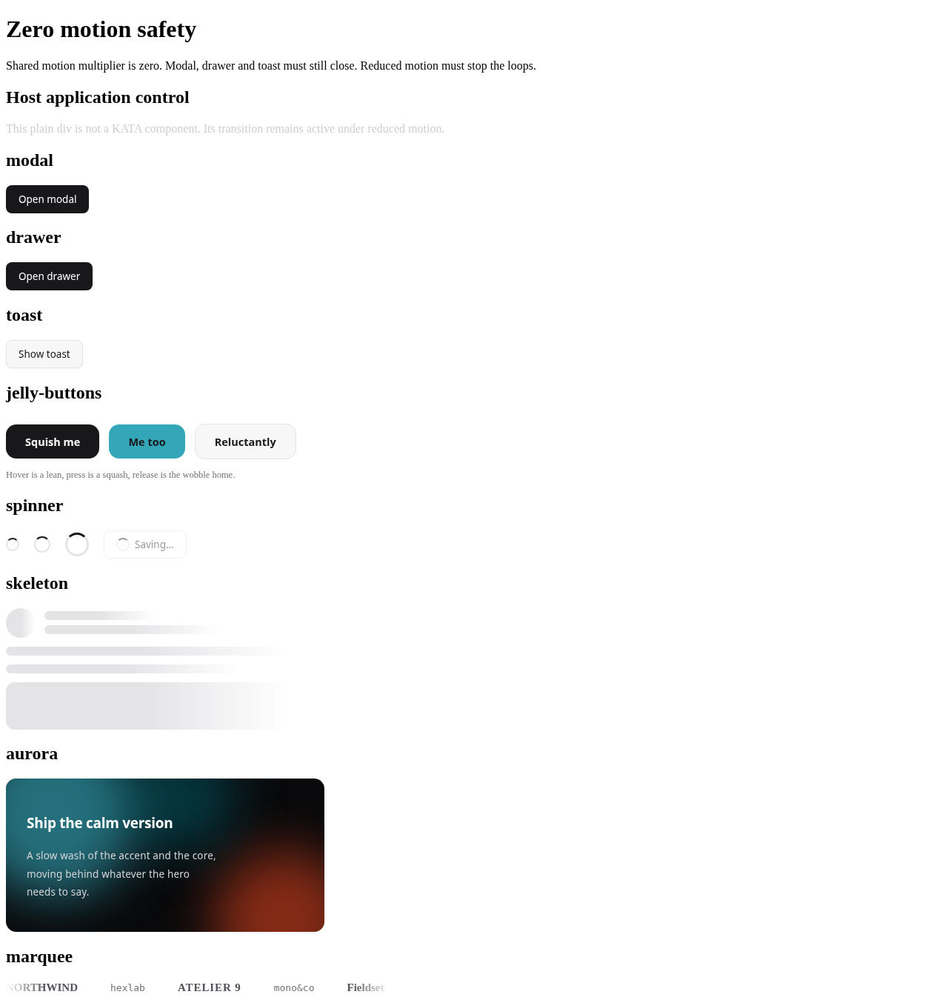

# Shared duration and easing migration — PR #21

Base: merged PR #20, commit c6982b885f9fd0331283c1b67991444bf9682922. Checker rules, color and border declarations are unchanged.

Mold **53 / 164 → 88 / 164**; UI **42 / 121 → 59 / 121**, Lab **11 / 43 → 29 / 43**. Token findings **137 → 20**: duration **107 → 0**, easing **10 → 0**, color **19 → 19**, border **1 → 1**.

## Canonical shared tokens

`system/tokens.json` is canonical; `tools/sync_shape_tokens.py` generates tokens.css. Existing numbered public names remain aliases; callers must not multiply those aliases again. Button was the only in-repo numbered-duration consumer already multiplying the token, so its redundant product was removed. No component-prefixed shared token is added.

| Token | Generated value |
|---|---|
| --k-mscale | 1 |
| --k-dur-fast | calc(130ms * var(--k-mscale)) |
| --k-dur-base | calc(180ms * var(--k-mscale)) |
| --k-dur-slow | calc(220ms * var(--k-mscale)) |
| --k-dur-1 | var(--k-dur-fast) |
| --k-dur-2 | var(--k-dur-base) |
| --k-dur-3 | var(--k-dur-slow) |
| --k-ease | cubic-bezier(.3,.7,.3,1) (unchanged) |
| --k-ease-out | cubic-bezier(.6,0,.2,1) |
| --k-ease-spring | cubic-bezier(.3,1.2,.4,1) |
| --k-ease-bounce | cubic-bezier(.3,2.2,.45,1) |

Foundry writes the existing --k-mscale. Its slider now covers 0–2, including a persisted zero; saved zero is no longer skipped by a truthy check. Design-system samples use the generated tokens and list all four named curves. Foundry also displays the effective fast/base/slow times from canonical JSON. Its actual scale 2, persisted zero and OS reduced-motion override were checked on the generated design-system page (foundry.json). The three added curves distinguish exits, gentle overshoot, and pronounced Lab overshoot. Existing --k-ease is retained.

Before: the root multiplier had no default, numbered durations were unscaled, and global reduced-motion used .01ms / one iteration (some components already disabled their own animations). After: the default multiplier is 1; reduced motion sets it to 0 !important and uses animation:none / transition:none !important for elements and pseudos. This stops infinite CSS animations, even if Foundry sets a nonzero inline multiplier. JavaScript scheduling clocks and dwell times are not motion durations and remain unchanged.

## Final duration mapping

| Original UI discrete duration | Token | Base duration |
|---|---|---:|
| >0–150ms | --k-dur-fast | 130ms |
| 151–200ms | --k-dur-base | 180ms |
| 201–400ms | --k-dur-slow | 220ms |
| UI duration >400ms | calc(original * var(--k-mscale)) | original |
| UI continuous / infinite animation | calc(original * var(--k-mscale)) | original |
| Lab duration and delay | calc(original * var(--k-mscale)) | original |
| Explicit delay / stagger arithmetic | calc(original * var(--k-mscale)) | original |

Explicit zero remains zero. Existing local loop parameters already multiplied by --k-mscale are preserved. Aurora remains 9s / 12s / 11s / 26s at multiplier 1; skeleton, spinner and marquee keep their periods. No loop is shortened to the UI transition scale.

## Easing approximation map

| Original curve | Shared curve |
|---|---|
| cubic-bezier(.2,.6,.2,1) | --k-ease |
| cubic-bezier(.2,.7,.2,1) | --k-ease |
| cubic-bezier(.2,.8,.25,1.2) | --k-ease-spring |
| cubic-bezier(.2,1.6,.4,1) | --k-ease-spring |
| cubic-bezier(.3,.7,.3,1) | --k-ease |
| cubic-bezier(.3,1.2,.4,1) | --k-ease-spring |
| cubic-bezier(.3,2.2,.45,1) | --k-ease-bounce |
| cubic-bezier(.3,2.3,.4,1) | --k-ease-bounce |
| cubic-bezier(.3,2.4,.45,1) | --k-ease-bounce |
| cubic-bezier(.4,0,.2,1) | --k-ease-out |
| cubic-bezier(.5,0,.2,1) | --k-ease-out |
| cubic-bezier(.6,-0.1,.2,1.25) | --k-ease-spring |
| cubic-bezier(.6,0,.2,1) | --k-ease-out |
| cubic-bezier(.65,0,.2,1) | --k-ease-out |

Standard CSS easing keywords remain unchanged. Curves with pronounced overshoot (>1.6) use bounce, modest overshoot uses spring, and slow-start exit curves use out. Other close monotonic curves use the existing default. This intentionally changes curve shape; original → new declarations are recorded below.

## JavaScript end-event audit

| Component | Previous completion mechanism | Change |
|---|---|---|
| modal | native dialog.close(), no end-event wait | unchanged; zero/reduced open-close tested |
| drawer | native dialog.close(), no end-event wait | unchanged; zero/reduced open-close tested |
| toast | 4000ms dwell + hard-coded .3s fade / 320ms removal | shared slow fade; computed duration zero removes immediately; end/cancel + computed timeout fallback |
| popover | synchronous class and aria-expanded toggle | unchanged; no end-event wait |
| accordion | native details, no JS file | unchanged; no end-event wait |
| jelly-buttons | animationend removes squish | zero/none immediate; end/cancel handler + computed duration/delay timeout fallback |

A search across component/block/template JS and inline example HTML found only the Jelly Buttons animationend listener before this change, and no transitionend dependency. Toast and Jelly now use an IIFE, querySelectorAll and data-kata-ready guards. No IDs or keyboard event handlers are introduced. Toast keeps its 4000ms dwell; the user-visible delay is not scaled. Arbitrary original paint such as its SVG stroke is untouched.

## Computed durations: 12 parts

Chromium actual computed transition / animation values, in seconds. Dependency controls such as Button are included; Modal itself has no animation. Each cell deduplicates all matching element/pseudo durations in the real preview with popups opened. `0` means no CSS motion is specified. The harness does **not** disable motion. All nonzero after values at multiplier 2 are exactly four times those at .5, including pre-existing button spinner timing.

| Part | Before ×.5 (T / A) | Before ×2 (T / A) | After ×.5 (T / A) | After ×2 (T / A) |
|---|---|---|---|---|
| button | 0.065s / 0.35s | 0.26s / 1.4s | 0.065s / 0.35s | 0.26s / 1.4s |
| input | 0 / 0 | 0 / 0 | 0 / 0 | 0 / 0 |
| select | 0.15s / 0 | 0.15s / 0 | 0.065s / 0 | 0.26s / 0 |
| card | 0.065s / 0 | 0.26s / 0 | 0.065s / 0 | 0.26s / 0 |
| badge | 0 / 0 | 0 / 0 | 0 / 0 | 0 / 0 |
| modal | 0.065s / 0 | 0.26s / 0 | 0.065s / 0 | 0.26s / 0 |
| drawer | 0.065s / 0.18s | 0.26s / 0.18s | 0.065s / 0.09s | 0.26s / 0.36s |
| dropdown | 0.065s, 0.15s / 0 | 0.15s, 0.26s / 0 | 0.065s / 0 | 0.26s / 0 |
| popover | 0.065s, 0.13s / 0 | 0.13s, 0.26s / 0 | 0.065s / 0 | 0.26s / 0 |
| tabs | 0.22s / 0 | 0.22s / 0 | 0.11s / 0 | 0.44s / 0 |
| toast | 0.065s / 0.3s | 0.26s / 0.3s | 0.065s / 0.11s | 0.26s / 0.44s |
| tooltip | 0.065s, 0.15s / 0 | 0.15s, 0.26s / 0 | 0.065s / 0 | 0.26s / 0 |

## Zero and reduced-motion safety

| Setting | Effective multiplier | Modal / Drawer | Toast after dwell | Jelly | Running animations |
|---|---:|---|---|---|---|
| no-preference, inline 0 | 0 | opened and closed | removed | reset; double load safe | 0 |
| reduce, inline 2 | 0 | opened and closed | removed | reset; double load safe | 0 |

The test page includes spinner, skeleton, Aurora and marquee loops. Reduced motion has no running CSS animation. The zero multiplier also passes the dialog and toast checks. Toast and Jelly scripts are each loaded twice; neither registers a duplicate action. Regression tests also suppress animation completion events and verify Jelly timeout cleanup.




## Every changed motion declaration

| File / property | Before | After |
|---|---|---|
| components/accordion/accordion.css / transition | `transform .18s cubic-bezier(.3,.7,.3,1)` | `transform var(--k-dur-base) var(--k-ease)` |
| components/accordion-gallery/accordion-gallery.css / transition | `flex .55s cubic-bezier(.6,0,.2,1)` | `flex calc(.55s * var(--k-mscale)) var(--k-ease-out)` |
| components/accordion-gallery/accordion-gallery.css / transition | `opacity .3s .18s` | `opacity calc(.3s * var(--k-mscale)) calc(.18s * var(--k-mscale))` |
| components/aurora/aurora.css / animation | `k-aur-a 9s var(--k-ease) infinite alternate` | `k-aur-a calc(9s * var(--k-mscale)) var(--k-ease) infinite alternate` |
| components/aurora/aurora.css / animation | `k-aur-b 12s var(--k-ease) infinite alternate` | `k-aur-b calc(12s * var(--k-mscale)) var(--k-ease) infinite alternate` |
| components/aurora/aurora.css / animation | `k-aur-c 11s var(--k-ease) infinite alternate` | `k-aur-c calc(11s * var(--k-mscale)) var(--k-ease) infinite alternate` |
| components/aurora/aurora.css / animation | `k-aur-pat 26s linear infinite alternate` | `k-aur-pat calc(26s * var(--k-mscale)) linear infinite alternate` |
| components/beam-border/beam-border.css / animation | `k-beam-spin 4.5s linear infinite` | `k-beam-spin calc(4.5s * var(--k-mscale)) linear infinite` |
| components/blur-in/blur-in.css / animation | `k-blur-in .7s cubic-bezier(.2,.6,.2,1) forwards` | `k-blur-in calc(.7s * var(--k-mscale)) var(--k-ease) forwards` |
| components/bounce-letters/bounce-letters.css / transition | `transform .34s cubic-bezier(.3,2.3,.4,1)` | `transform calc(.34s * var(--k-mscale)) var(--k-ease-bounce)` |
| components/burst-button/burst-button.css / transition | `transform .12s` | `transform calc(.12s * var(--k-mscale))` |
| components/button/button.css / transition | `background-color calc(var(--k-dur-1) * var(--k-mscale, 1)) var(--k-ease),color calc(var(--k-dur-1) * var(--k-mscale, 1)) var(--k-ease),box-shadow calc(var(--k-dur-1) * var(--k-mscale, 1)) var(--k-ease)` | `background-color var(--k-dur-1) var(--k-ease),color var(--k-dur-1) var(--k-ease),box-shadow var(--k-dur-1) var(--k-ease)` |
| components/carousel/carousel.css / transition | `width .18s var(--k-ease),background .18s` | `width var(--k-dur-base) var(--k-ease),background var(--k-dur-base)` |
| components/carousel-ring/carousel-ring.css / animation | `k-ring-spin 26s linear infinite` | `k-ring-spin calc(26s * var(--k-mscale)) linear infinite` |
| components/checkbox/checkbox.css / transition | `background .13s,border-color .13s` | `background var(--k-dur-fast),border-color var(--k-dur-fast)` |
| components/checkbox/checkbox.css / transition | `transform .13s` | `transform var(--k-dur-fast)` |
| components/collapsible/collapsible.css / transition | `transform .18s` | `transform var(--k-dur-base)` |
| components/color-picker/color-picker.css / transition | `transform .12s var(--k-ease)` | `transform var(--k-dur-fast) var(--k-ease)` |
| components/converge/converge.css / animation | `k-conv-pulse 3.4s var(--k-ease) infinite alternate` | `k-conv-pulse calc(3.4s * var(--k-mscale)) var(--k-ease) infinite alternate` |
| components/converge/converge.css / animation | `k-conv-tw 2.2s ease-in-out infinite alternate` | `k-conv-tw calc(2.2s * var(--k-mscale)) ease-in-out infinite alternate` |
| components/converge/converge.css / animation-delay | `.5s` | `calc(.5s * var(--k-mscale))` |
| components/converge/converge.css / animation-delay | `1.1s` | `calc(1.1s * var(--k-mscale))` |
| components/converge/converge.css / animation-delay | `1.6s` | `calc(1.6s * var(--k-mscale))` |
| components/copy-field/copy-field.css / transition | `background .15s` | `background var(--k-dur-fast)` |
| components/data-table/data-table.css / transition | `transform .15s var(--k-ease),opacity .15s` | `transform var(--k-dur-fast) var(--k-ease),opacity var(--k-dur-fast)` |
| components/dock/dock.css / transition | `transform .14s ease-out` | `transform calc(.14s * var(--k-mscale)) ease-out` |
| components/dock/dock.css / transition | `opacity .15s,transform .15s` | `opacity calc(.15s * var(--k-mscale)),transform calc(.15s * var(--k-mscale))` |
| components/dropdown/dropdown.css / transition | `opacity .15s,transform .15s` | `opacity var(--k-dur-fast),transform var(--k-dur-fast)` |
| components/file-upload/file-upload.css / transition | `border-color .15s,background .15s` | `border-color var(--k-dur-fast),background var(--k-dur-fast)` |
| components/glow-button/glow-button.css / animation | `k-ga-spin 3.6s linear infinite` | `k-ga-spin calc(3.6s * var(--k-mscale)) linear infinite` |
| components/glow-button/glow-button.css / transition | `box-shadow .3s` | `box-shadow calc(.3s * var(--k-mscale))` |
| components/glow-button/glow-button.css / transition | `background .3s, box-shadow .3s` | `background calc(.3s * var(--k-mscale)), box-shadow calc(.3s * var(--k-mscale))` |
| components/glow-button/glow-button.css / animation | `k-ga-spin 3.6s linear infinite` | `k-ga-spin calc(3.6s * var(--k-mscale)) linear infinite` |
| components/glow-cards/glow-cards.css / transition | `opacity .25s` | `opacity calc(.25s * var(--k-mscale))` |
| components/goo-tabs/goo-tabs.css / transition | `left .45s cubic-bezier(.6,-0.1,.2,1.25), width .45s cubic-bezier(.6,-0.1,.2,1.25), transform .3s` | `left calc(.45s * var(--k-mscale)) var(--k-ease-spring), width calc(.45s * var(--k-mscale)) var(--k-ease-spring), transform calc(.3s * var(--k-mscale))` |
| components/goo-tabs/goo-tabs.css / transition | `color .25s` | `color calc(.25s * var(--k-mscale))` |
| components/hanko/hanko.css / animation | `k-seal-in .5s cubic-bezier(.2,1.6,.4,1)` | `k-seal-in calc(.5s * var(--k-mscale)) var(--k-ease-spring)` |
| components/hanko/hanko.css / animation | `k-seal-ring .55s ease-out` | `k-seal-ring calc(.55s * var(--k-mscale)) ease-out` |
| components/hover-card/hover-card.css / transition | `opacity .16s var(--k-ease),transform .16s var(--k-ease)` | `opacity var(--k-dur-base) var(--k-ease),transform var(--k-dur-base) var(--k-ease)` |
| components/input-otp/input-otp.css / transition | `border-color .13s, box-shadow .13s` | `border-color var(--k-dur-fast), box-shadow var(--k-dur-fast)` |
| components/jelly-buttons/jelly-buttons.css / transition | `transform .28s cubic-bezier(.3,2.4,.45,1)` | `transform calc(.28s * var(--k-mscale)) var(--k-ease-bounce)` |
| components/jelly-buttons/jelly-buttons.css / animation | `k-jelly-wob .55s cubic-bezier(.3,2.2,.45,1)` | `k-jelly-wob calc(.55s * var(--k-mscale)) var(--k-ease-bounce)` |
| components/liquid-button/liquid-button.css / transition | `transform .65s cubic-bezier(.5,0,.2,1)` | `transform calc(.65s * var(--k-mscale)) var(--k-ease-out)` |
| components/liquid-button/liquid-button.css / transition | `color .4s` | `color calc(.4s * var(--k-mscale))` |
| components/magnet/magnet.css / transition | `transform .35s cubic-bezier(.2,.8,.25,1.2)` | `transform calc(.35s * var(--k-mscale)) var(--k-ease-spring)` |
| components/magnet/magnet.css / transition | `transform .12s ease-out` | `transform calc(.12s * var(--k-mscale)) ease-out` |
| components/marquee/marquee.css / animation | `k-marquee 30s linear infinite` | `k-marquee calc(30s * var(--k-mscale)) linear infinite` |
| components/navigation-menu/navigation-menu.css / transition | `transform .18s` | `transform var(--k-dur-base)` |
| components/newtons-cradle/newtons-cradle.css / animation | `k-cr-l 2.4s ease-in-out infinite` | `k-cr-l calc(2.4s * var(--k-mscale)) ease-in-out infinite` |
| components/newtons-cradle/newtons-cradle.css / animation | `k-cr-r 2.4s ease-in-out infinite` | `k-cr-r calc(2.4s * var(--k-mscale)) ease-in-out infinite` |
| components/noren/noren.css / transition | `transform .5s cubic-bezier(.4,0,.2,1)` | `transform calc(.5s * var(--k-mscale)) var(--k-ease-out)` |
| components/noren/noren.css / animation | `k-nor-sway 5.2s ease-in-out infinite alternate` | `k-nor-sway calc(5.2s * var(--k-mscale)) ease-in-out infinite alternate` |
| components/noren/noren.css / animation | `k-nor-sway 6.4s ease-in-out infinite alternate-reverse` | `k-nor-sway calc(6.4s * var(--k-mscale)) ease-in-out infinite alternate-reverse` |
| components/noren/noren.css / animation | `k-nor-sway 5.8s ease-in-out infinite alternate` | `k-nor-sway calc(5.8s * var(--k-mscale)) ease-in-out infinite alternate` |
| components/orbit/orbit.css / animation-duration | `16s` | `calc(16s * var(--k-mscale))` |
| components/orbit/orbit.css / animation-duration | `26s` | `calc(26s * var(--k-mscale))` |
| components/orbit/orbit.css / animation-duration | `16s` | `calc(16s * var(--k-mscale))` |
| components/orbit/orbit.css / animation-duration | `26s` | `calc(26s * var(--k-mscale))` |
| components/pagination/pagination.css / transition | `background .13s` | `background var(--k-dur-fast)` |
| components/progress/progress.css / transition | `width .3s cubic-bezier(.3,.7,.3,1)` | `width var(--k-dur-slow) var(--k-ease)` |
| components/radio/radio.css / transition | `border-color .15s` | `border-color var(--k-dur-fast)` |
| components/radio/radio.css / transition | `transform .15s cubic-bezier(.3,.7,.3,1)` | `transform var(--k-dur-fast) var(--k-ease)` |
| components/rating/rating.css / transition | `fill .12s` | `fill var(--k-dur-fast)` |
| components/segmented/segmented.css / transition | `background .15s,color .15s` | `background var(--k-dur-fast),color var(--k-dur-fast)` |
| components/select/select.css / transition | `border-color .15s` | `border-color var(--k-dur-fast)` |
| components/shine-text/shine-text.css / animation | `k-shine-move 3.4s linear infinite` | `k-shine-move calc(3.4s * var(--k-mscale)) linear infinite` |
| components/sidebar/sidebar.css / transition | `transform .18s` | `transform var(--k-dur-base)` |
| components/skeleton/skeleton.css / animation | `k-shimmer 1.4s ease-in-out infinite` | `k-shimmer calc(1.4s * var(--k-mscale)) ease-in-out infinite` |
| components/speed-dial/speed-dial.css / transition | `opacity .18s,transform .18s` | `opacity var(--k-dur-base),transform var(--k-dur-base)` |
| components/speed-dial/speed-dial.css / transition | `transform .2s` | `transform var(--k-dur-base)` |
| components/spinner/spinner.css / animation | `k-spin .7s linear infinite` | `k-spin calc(.7s * var(--k-mscale)) linear infinite` |
| components/spinner/spinner.css / animation-duration | `1.6s` | `calc(1.6s * var(--k-mscale))` |
| components/stepper/stepper.css / transition | `background .13s` | `background var(--k-dur-fast)` |
| components/switch/switch.css / transition | `background .18s` | `background var(--k-dur-base)` |
| components/switch/switch.css / transition | `transform .18s` | `transform var(--k-dur-base)` |
| components/tabs/tabs.css / transition | `left .22s cubic-bezier(.3,.7,.3,1),width .22s cubic-bezier(.3,.7,.3,1)` | `left var(--k-dur-slow) var(--k-ease),width var(--k-dur-slow) var(--k-ease)` |
| components/tag-input/tag-input.css / transition | `border-color .13s, box-shadow .13s` | `border-color var(--k-dur-fast), box-shadow var(--k-dur-fast)` |
| components/tategaki/tategaki.css / animation | `k-tate-in 1s cubic-bezier(.2,.7,.2,1) both` | `k-tate-in calc(1s * var(--k-mscale)) var(--k-ease) both` |
| components/tategaki/tategaki.css / animation-delay | `.05s` | `calc(.05s * var(--k-mscale))` |
| components/tategaki/tategaki.css / animation-delay | `.22s` | `calc(.22s * var(--k-mscale))` |
| components/tategaki/tategaki.css / animation-delay | `.39s` | `calc(.39s * var(--k-mscale))` |
| components/text-reveal/text-reveal.css / transition | `transform .7s cubic-bezier(.3,.7,.3,1)` | `transform calc(.7s * var(--k-mscale)) var(--k-ease)` |
| components/text-reveal/text-reveal.css / transition-delay | `calc(var(--i,0)*45ms)` | `calc(var(--i,0)*calc(45ms * var(--k-mscale)))` |
| components/textarea/textarea.css / transition | `border-color .15s,box-shadow .15s` | `border-color var(--k-dur-fast),box-shadow var(--k-dur-fast)` |
| components/tilt-card/tilt-card.css / transition | `transform .3s ease-out` | `transform calc(.3s * var(--k-mscale)) ease-out` |
| components/tilt-card/tilt-card.css / transition | `transform .08s linear` | `transform calc(.08s * var(--k-mscale)) linear` |
| components/toast/toast.css / animation | `k-tin .3s cubic-bezier(.3,1.2,.4,1)` | `k-tin var(--k-dur-slow) var(--k-ease-spring)` |
| components/toggle/toggle.css / transition | `background .13s,border-color .13s,color .13s` | `background var(--k-dur-fast),border-color var(--k-dur-fast),color var(--k-dur-fast)` |
| components/tooltip/tooltip.css / transition | `opacity .15s,transform .15s` | `opacity var(--k-dur-fast),transform var(--k-dur-fast)` |
| components/tooltip/tooltip.css / transition | `opacity .15s` | `opacity var(--k-dur-fast)` |
| components/tree/tree.css / transition | `transform .15s var(--k-ease)` | `transform var(--k-dur-fast) var(--k-ease)` |
| components/typewriter/typewriter.css / animation | `k-type-blink 1.05s steps(1) infinite` | `k-type-blink calc(1.05s * var(--k-mscale)) steps(1) infinite` |
| components/warp-tunnel/preview.html / animation-delay | `0.00s` | `calc(0.00s * var(--k-mscale))` |
| components/warp-tunnel/preview.html / animation-delay | `0.42s` | `calc(0.42s * var(--k-mscale))` |
| components/warp-tunnel/preview.html / animation-delay | `0.84s` | `calc(0.84s * var(--k-mscale))` |
| components/warp-tunnel/preview.html / animation-delay | `1.26s` | `calc(1.26s * var(--k-mscale))` |
| components/warp-tunnel/preview.html / animation-delay | `1.68s` | `calc(1.68s * var(--k-mscale))` |
| components/warp-tunnel/preview.html / animation-delay | `2.10s` | `calc(2.10s * var(--k-mscale))` |
| components/warp-tunnel/preview.html / animation-delay | `2.52s` | `calc(2.52s * var(--k-mscale))` |
| components/warp-tunnel/preview.html / animation-delay | `2.94s` | `calc(2.94s * var(--k-mscale))` |
| components/warp-tunnel/preview.html / animation-delay | `3.36s` | `calc(3.36s * var(--k-mscale))` |
| components/warp-tunnel/preview.html / animation-delay | `3.78s` | `calc(3.78s * var(--k-mscale))` |
| components/warp-tunnel/preview.html / animation-delay | `4.20s` | `calc(4.20s * var(--k-mscale))` |
| components/warp-tunnel/preview.html / animation-delay | `4.62s` | `calc(4.62s * var(--k-mscale))` |
| components/warp-tunnel/warp-tunnel.css / animation | `k-warp-fly 5s linear infinite` | `k-warp-fly calc(5s * var(--k-mscale)) linear infinite` |
| components/word-rotate/word-rotate.css / transition | `transform .55s cubic-bezier(.65,0,.2,1)` | `transform calc(.55s * var(--k-mscale)) var(--k-ease-out)` |
| blocks/integrations/integrations.css / transition | `border-color .14s` | `border-color var(--k-dur-fast)` |
| blocks/use-cases/use-cases.css / transition | `transform .2s var(--k-ease)` | `transform var(--k-dur-base) var(--k-ease)` |
| blocks/use-cases/use-cases.css / animation | `k-uc-in .45s var(--k-ease)` | `k-uc-in calc(.45s * var(--k-mscale)) var(--k-ease)` |

## Verification and limits

- `python3 check.py --json mold-results.json`: 88/164, expected exit 1 for the existing 76 failed parts; duration/easing zero. No new color/border finding.
- `python3 -W error::SyntaxWarning build.py`: successful regeneration (registry, distributions, site, README/llms/Skill and audit/roadmap). No source rewrite conflicts.
- Node syntax checks for Toast and Jelly Buttons; unit tests; template probe; baseline ratchet and generated surface checks.
- Existing contrast regression tests now disable transitions in their isolated fixture, matching their settled-color purpose. Otherwise a palette change under a moving pointer sampled interpolated colors and failed nondeterministically. No production color or checker rule changes.
- Not verified: Firefox/Safari, screen readers, JS-rendered/RAF Lab effects, all animation phases or every Lab effect visually. The timing table covers the named 12 components; zero/reduced-motion safety covers the supplied test page.

Reproduce:
```sh
python3 -m tools.capture_motion_migration --before-ref c6982b885f9fd0331283c1b67991444bf9682922
python3 -m unittest discover -s tests -p "test_*.py"
```
