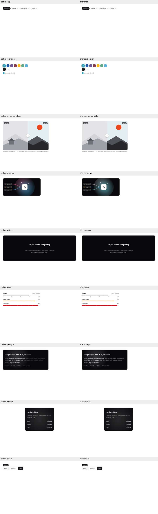
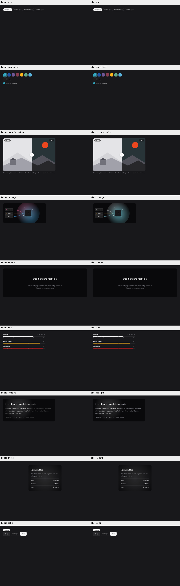
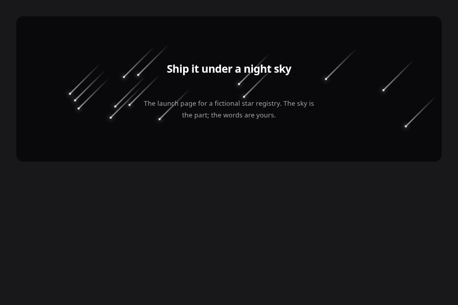

> Historical pre-rebase evidence: 56/164. The current integrated result is **94/164, token-values 0**. [Latest record](integrated/README.md).

# Shared paint migration — PR #22

Base: main `c6982b885f9fd0331283c1b67991444bf9682922`. PR #21 remains open and is deliberately not included. No checker rules, duration/easing declarations, core vermilion or shared palette values are changed.

Mold **53 / 164 → 56 / 164**, UI **42 / 121 → 43 / 121**, Lab **11 / 43 → 13 / 43**. Token findings **137 → 117**: color **19 → 0**, border **1 → 0**; duration **107**, easing **10** remain on main. Newly passing: Meteors, Meter and Spotlight. No status is promoted.

No shared token is added. All substitutions use existing semantic or fixed-palette tokens.

## Every replacement

| File | Before | After |
|---|---|---|
| components/chip/chip.css | `rgba(255,255,255,.16)` | `color-mix(in srgb,var(--k-bg) 16%,transparent)` |
| components/color-picker/color-picker.css | `color:#fff` | `color:var(--k-on-color)` |
| components/color-picker/preview.html | `background:hsl(175 84% 32%)` | `background:var(--k-accent)` |
| components/comparison-slider/comparison-slider.css | `rgba(24,24,27,.72)` | `color-mix(in srgb,var(--k-zinc-900) 72%,transparent)` |
| components/converge/converge.css | `hsl(335 85% 68%)` | `var(--k-zinc-300)` |
| components/converge/converge.css | `hsl(32 95% 60%)` | `var(--k-yamabuki)` |
| components/converge/converge.css | `hsl(205 90% 63%)` | `var(--k-asagi-300)` |
| components/converge/preview.html | `hsl(335 85% 72%)` | `var(--k-zinc-300)` |
| components/converge/preview.html | `hsl(32 95% 64%)` | `var(--k-yamabuki)` |
| components/converge/preview.html | `hsl(205 90% 66%)` | `var(--k-asagi-300)` |
| components/meteors/meteors.css | `rgba(255,255,255,.75)` | `color-mix(in srgb,var(--k-zinc-50) 75%,transparent)` |
| components/meter/meter.css | `rgba(255,255,255,.5)` | `color-mix(in srgb,var(--k-bg) 50%,transparent)` |
| components/spotlight/spotlight.css | `rgba(255,255,255,.17)` | `color-mix(in srgb,var(--k-zinc-50) 17%,transparent)` |
| components/spotlight/spotlight.css | `rgba(255,255,255,.05)` | `color-mix(in srgb,var(--k-zinc-50) 5%,transparent)` |
| components/spotlight/spotlight.css | `rgba(255,255,255,.3)` | `var(--k-zinc-400)` |
| components/spotlight/spotlight.css | `#000` | `var(--k-zinc-950)` |
| components/spotlight/spotlight.css | `rgba(0,0,0,.5)` | `color-mix(in srgb,var(--k-zinc-950) 50%,transparent)` |
| components/tilt-card/tilt-card.css | `rgba(255,255,255,.14)` | `color-mix(in srgb,var(--k-zinc-50) 14%,transparent)` |
| components/tooltip/tooltip.css | `border:5px solid transparent;border-top-color:var(--k-ink)` | `width:calc(var(--k-space-2) * 1.25);height:calc(var(--k-space-2) * 1.25);box-sizing:border-box;border:1px solid var(--k-line);background:var(--k-ink);clip-path:polygon(0 0,100% 0,50% 50%)` |
| components/tooltip/tooltip.css | `border-top-color:transparent;border-bottom-color:var(--k-ink)` | `clip-path:polygon(0 100%,100% 100%,50% 50%)` |

Selected Chip controls and Meter ticks use bg as the inverse surface role. Color Picker uses on-color for its existing white data-swatch indicator; labeled custom swatch values remain data under the unchanged checker policy. Its initial output chip now uses accent before the existing JS synchronizes it. These indicators are not text samples; their full non-text state contrast / ARIA behavior is outside this measurement.

Lab fixed paint never reads a theme-dependent text role. Comparison labels retain exact zinc-900 at 72%; Meteors / Spotlight / Tilt use zinc-50 for bright effects. Converge maps pink to fixed zinc-300, orange to existing fixed yamabuki and blue to fixed asagi-300. This is a visible palette approximation, not an exact hue match. No new component or shared colors were introduced. Spotlight replaces its 30%-white base text with opaque zinc-400 so words remain readable outside the beam. Its description and accessibility text now state the implemented readable base + aria-hidden clone behavior. Status remains Beta.

Tooltip had no colored 5px border violation: the failure was its 5px transparent triangle geometry. The arrow now uses a 1px line border, ink fill and a percentage clip-path. Its bounding box stays 10×10px via calc(space-2 * 1.25), with the original top/bottom direction retained. Both arrow orientations were photographed. Mask colors in Spotlight were also migrated to fixed tokens, preserving their alpha-mask role.

## All changed parts, light and dark

Nine parts, 36 individual before/after images, plus arrow directions, visible Meteor phases and pixel-diff images. Seeded random values and paused SVG motion make the comparison reproducible. Default captures use PR #20 reduced-motion harness. Meteors are normally hidden there, so extra non-reduced captures pause each meteor at 35% of its seeded flight.






| Changed part | Light before → after | Dark before → after | Changed pixels light / dark |
|---|---:|---:|---:|
| chip | 17.72 → 17.72 | 16.12 → 16.12 | 0 / 305 |
| color-picker | 7.73 → 7.73 | 6.91 → 6.91 | 0 / 0 |
| comparison-slider | 4.83 → 4.83 | 5.60 → 5.60 | 0 / 0 |
| converge | 15.87 → 15.87 | 15.87 → 15.87 | 35846 / 35846 |
| meteors | 7.76 → 7.76 | 7.76 → 7.76 | 0 / 0 |
| meter | 4.83 → 4.83 | 5.60 → 5.60 | 116 / 234 |
| spotlight | 2.60 → 7.76 | 2.60 → 7.76 | 28402 / 28402 |
| tilt-card | 7.76 → 7.76 | 7.76 → 7.76 | 33271 / 33271 |
| tooltip | 16.54 → 16.54 | 13.55 → 13.55 | 0 / 0 |

All measured eligible changed-part text samples are ≥4.5:1 in both themes. Alpha-mask boundaries, pseudo-overlay gradients and antialiasing are not modeled by this computed-color metric; see limits below.

## PR #20 40-part contrast rerun

The same script, row filters and WCAG/alpha-composition method are reused. The only tool change is an output-directory option so the original PR #20 evidence stays intact. Each cell is the minimum eligible default/open-preview text contrast. Placeholder text is included. Disabled controls and their associated labels are exempt but listed separately.

| Part | PR #20 light → rerun | PR #20 dark → rerun | Disabled minimum after (light / dark) |
|---|---:|---:|---:|
| button | 5.79 → 5.79 | 5.79 → 5.79 | 2.92 / 4.19 |
| input | 4.83 → 4.83 | 5.60 → 5.60 | — / — |
| select | 17.72 → 17.72 | 16.12 → 16.12 | 3.38 / 4.88 |
| card | 4.51 → 4.51 | 4.71 → 4.71 | — / — |
| badge | 5.26 → 5.26 | 5.81 → 5.81 | — / — |
| modal | 7.73 → 7.73 | 6.91 → 6.91 | — / — |
| drawer | 7.73 → 7.73 | 6.91 → 6.91 | — / — |
| dropdown | 4.83 → 4.83 | 5.60 → 5.60 | — / — |
| popover | 7.73 → 7.73 | 6.91 → 6.91 | — / — |
| tabs | 6.55 → 6.55 | 5.81 → 5.81 | — / — |
| toast | 16.54 → 16.54 | 13.55 → 13.55 | — / — |
| tooltip | 16.54 → 16.54 | 13.55 → 13.55 | — / — |
| field | 4.83 → 4.83 | 5.60 → 5.60 | — / — |
| textarea | 4.83 → 4.83 | 5.60 → 5.60 | — / — |
| checkbox | 17.72 → 17.72 | 16.12 → 16.12 | — / — |
| radio | 6.10 → 6.10 | 9.16 → 9.16 | 4.83 / 5.60 |
| switch | 17.72 → 17.72 | 16.12 → 16.12 | — / — |
| accordion | 7.73 → 7.73 | 6.91 → 6.91 | — / — |
| alert | 7.08 → 7.08 | 5.43 → 5.43 | — / — |
| table | 4.51 → 4.51 | 4.71 → 4.71 | — / — |
| pagination | 4.83 → 4.83 | 5.60 → 5.60 | — / — |
| breadcrumbs | 7.73 → 7.73 | 6.91 → 6.91 | — / — |
| combobox | 17.72 → 17.72 | 16.12 → 16.12 | — / — |
| input-otp | 17.72 → 17.72 | 16.12 → 16.12 | — / — |
| tag-input | 4.83 → 4.83 | 5.60 → 5.60 | — / — |
| file-upload | 4.83 → 4.83 | 5.60 → 5.60 | — / — |
| slider | 7.73 → 7.73 | 6.91 → 6.91 | — / — |
| dual-range | 4.83 → 4.83 | 5.60 → 5.60 | — / — |
| segmented | 6.55 → 6.55 | 5.81 → 5.81 | — / — |
| toggle | 7.73 → 7.73 | 6.91 → 6.91 | — / — |
| button-group | 17.72 → 17.72 | 16.12 → 16.12 | — / — |
| input-group | 7.22 → 7.22 | 5.81 → 5.81 | — / — |
| alert-dialog | 5.79 → 5.79 | 5.79 → 5.79 | — / — |
| command | 4.51 → 4.51 | 4.71 → 4.71 | — / — |
| context-menu | 4.83 → 4.83 | 5.60 → 5.60 | — / — |
| hover-card | 6.09 → 6.09 | 6.09 → 6.09 | — / — |
| navigation-menu | 4.83 → 4.83 | 5.60 → 5.60 | — / — |
| menubar | 4.83 → 4.83 | 5.60 → 5.60 | — / — |
| copy-field | 7.73 → 7.73 | 6.91 → 6.91 | — / — |
| collapsible | 7.73 → 7.73 | 6.91 → 6.91 | — / — |

light: 247 eligible default text samples, **0 below 4.5:1**.

dark: 247 eligible default text samples, **0 below 4.5:1**.

## State rerun

Values are scoped to each interacted element and its descendants, as in PR #20. The full default+state data is in contrast-40/after.json.

| Part / target / state | Light | Dark |
|---|---:|---:|
| button `.btn-accent / hover` | 6.88 | 6.88 |
| button `.btn-accent / active` | 6.15 | 6.15 |
| button `.btn-accent / focus` | 6.15 | 6.15 |
| button `.btn-danger / hover` | 5.57 | 7.24 |
| button `.btn-danger / active` | 5.79 | 5.79 |
| button `.btn-danger / focus` | 5.79 | 5.79 |
| dropdown `.menu a:not(.danger) / hover` | 16.54 | 13.55 |
| dropdown `.menu a:not(.danger) / active` | 16.54 | 13.55 |
| dropdown `.menu a:not(.danger) / focus` | 17.72 | 16.12 |
| dropdown `.menu a.danger / hover` | 5.84 | 6.29 |
| dropdown `.menu a.danger / active` | 5.84 | 6.29 |
| dropdown `.menu a.danger / focus` | 6.26 | 7.48 |
| context-menu `.k-ctx button:not(.danger) / hover` | 4.51 | 4.71 |
| context-menu `.k-ctx button:not(.danger) / active` | 4.51 | 4.71 |
| context-menu `.k-ctx button:not(.danger) / focus` | 4.51 | 4.71 |
| context-menu `.k-ctx button.danger / hover` | 4.51 | 4.71 |
| context-menu `.k-ctx button.danger / active` | 4.51 | 4.71 |
| context-menu `.k-ctx button.danger / focus` | 4.51 | 4.71 |
| tabs `.tabs button.on / hover` | 15.02 | 13.55 |
| tabs `.tabs button.on / active` | 15.02 | 13.55 |
| tabs `.tabs button.on / focus` | 15.02 | 13.55 |
| tabs `.tabs button:not(.on) / hover` | 6.55 | 5.81 |
| tabs `.tabs button:not(.on) / active` | 6.55 | 5.81 |
| tabs `.tabs button:not(.on) / focus` | 6.55 | 5.81 |
| pagination `a.k-page[aria-current="page"] / hover` | 16.54 | 13.55 |
| pagination `a.k-page[aria-current="page"] / active` | 16.54 | 13.55 |
| pagination `a.k-page[aria-current="page"] / focus` | 17.72 | 16.12 |
| pagination `a.k-page:not([aria-current]):not(.disabled) / hover` | 16.54 | 13.55 |
| pagination `a.k-page:not([aria-current]):not(.disabled) / active` | 16.54 | 13.55 |
| pagination `a.k-page:not([aria-current]):not(.disabled) / focus` | 7.73 | 6.91 |

## Verification and limits

- `python3 check.py --json mold-results.json`: 56/164, expected exit 1 for 108 existing failed parts. Color/border zero. All other finding counts unchanged.
- `python3 -W error::SyntaxWarning build.py`: regenerates distributions, registry, site/audit, README/llms/Skill and roadmap snapshot. Component sources are not overwritten; no generator conflict.
- `python3 -m tools.capture_paint_migration --before-ref c6982b885f9fd0331283c1b67991444bf9682922`: all nine changed parts × two themes × before/after; no page errors.
- `python3 -m tools.capture_text_contrast --phase after --limit 40 --output docs/review/shared-paint/contrast-40`: 494 eligible default text samples; 60 target/states; no sample below 4.5:1 and no page errors.
- 28 unit tests pass. The settled-color fixture now disables animation/transition, matching the existing screenshot harness and avoiding intermediate palette colors under a moving mouse. This is the same fixture correction present in open PR #21; no production contrast/check rule is relaxed.
- Template probe: ui 1/1, 0 warnings, temporary target removed. Baseline ratchet and generated token/audit surface checks pass.
- Not verified: Firefox/Safari, screen readers, full color-picker non-text indicator contrast/ARIA keyboard pattern, all effect phases, actual pixel contrast over gradients or partially masked text. The computed-color method does not account for background images, pseudo overlays or mask alpha. No whole-library WCAG conformance claim.
- PR #21 is still open at this base. If it merges first, regenerate audit, baseline and roadmap on the combined tree; do not overwrite its newer motion counts with this branch snapshot.

Reproduce:
```sh
python3 -m tools.capture_paint_migration --before-ref c6982b885f9fd0331283c1b67991444bf9682922
python3 -m tools.capture_text_contrast --phase after --limit 40 --output docs/review/shared-paint/contrast-40
```
