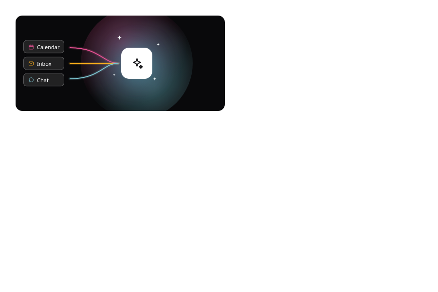
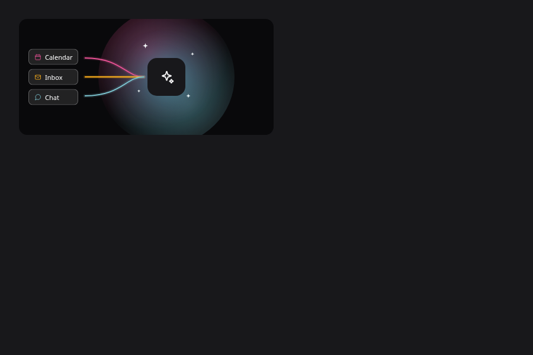
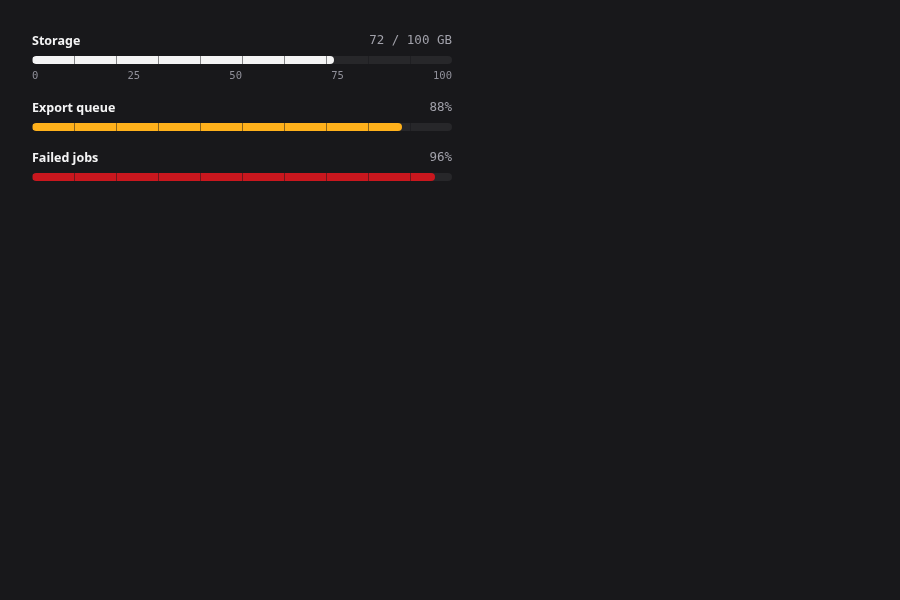
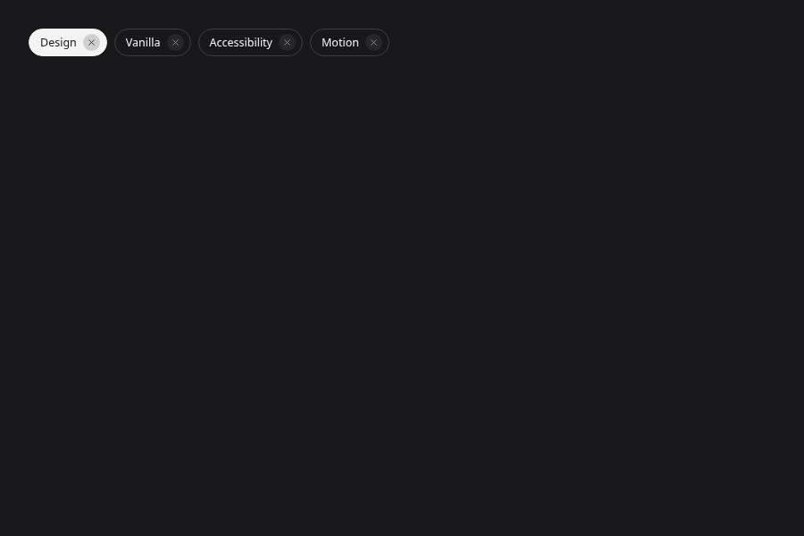

# Integrated PR #22 review

Rebased on merged PR #21. Mold **88 / 164 → 94 / 164** (UI **61 / 121**, Lab **33 / 43**). **token-values: 0** (color/border/duration/easing all zero). Historical pre-rebase result: **56 / 164**.

Conflicting baseline, roadmap, migration docs and generated outputs were taken from main, then regenerated. The identical settled-color test fixture merged cleanly. Component conflicts kept main motion declarations and reapplied only paint changes. No checker rule changes.

## Pink palette

--k-tsutsuji: #e95295 is fixed in both themes, owned by system/tokens.json. Its hue 333.38° is closer to original 335° than botan #e7609e (332.44°). One shared fixed token, no component namespace or extra shade. Foundry lists the new color and design-system publishes its value. Converge now shows pink / amber / blue.

## Highlight direction

Meter warning and critical fills use fixed yamabuki/danger, so a bg overlay wrongly darkened them in dark mode. All stripe overlays now use fixed zinc-50 at 50%. Chip selected surfaces use ink, which becomes light in dark mode; its bg 16% overlay correctly reverses to a dark shading on that light surface and is retained. This is an inverse-pair control treatment rather than a fixed-surface highlight.

The main-before and integrated-after images are adjacent. Review-correction images compare directly against the old PR #22 (ad68552), including the gray Converge and dark meter overlays:

## Verification

All nine affected components were captured before/after in light/dark. The PR #20 40-part and state rerun has no eligible text below 4.5:1; disabled samples remain exempt in JSON. No page errors. 29 unit tests, warning-as-error build, template probe, ratchet and generated-surface checks pass. Baseline and ROADMAP were regenerated; Phase 0 records 2026-11-05 and PR #22 as the token-values-zero milestone.

Original images and reports one directory above are historical, pre-rebase evidence. Use this integrated folder for the current result. Browser limitations remain as previously recorded (Firefox/Safari, screen readers, gradients/masks and full non-text icon-state coverage).
