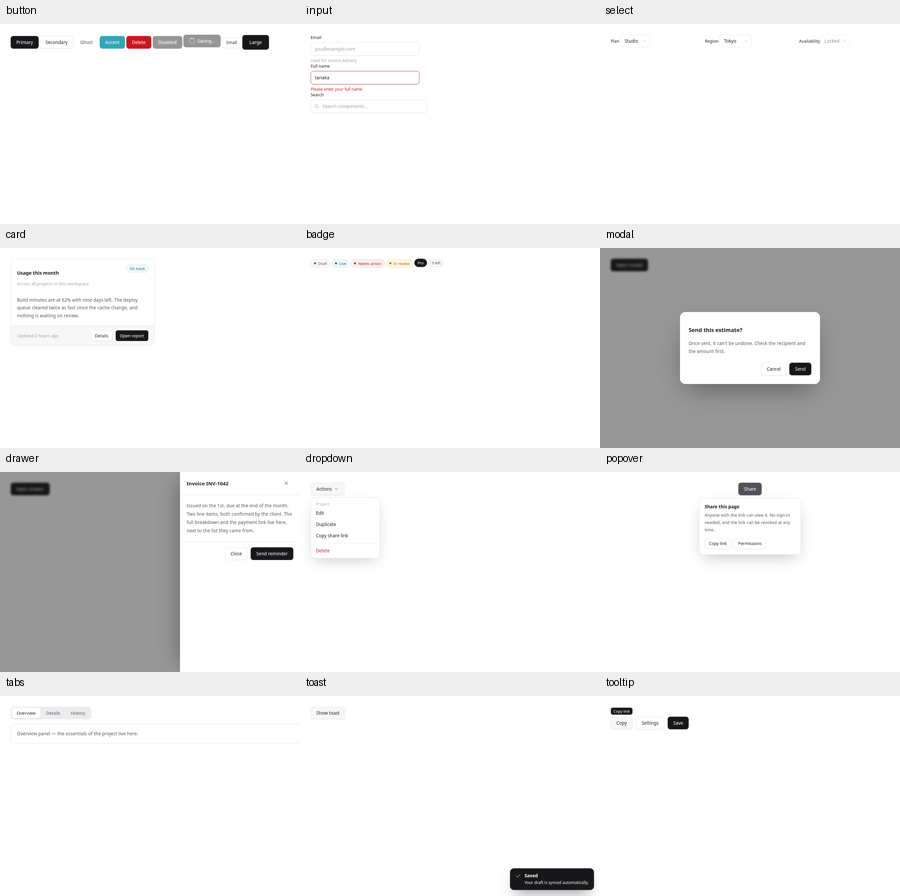
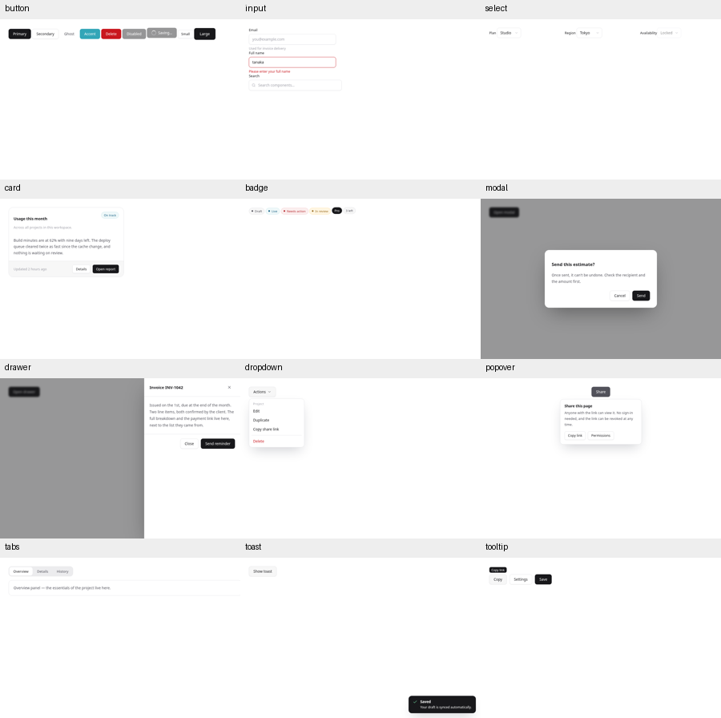
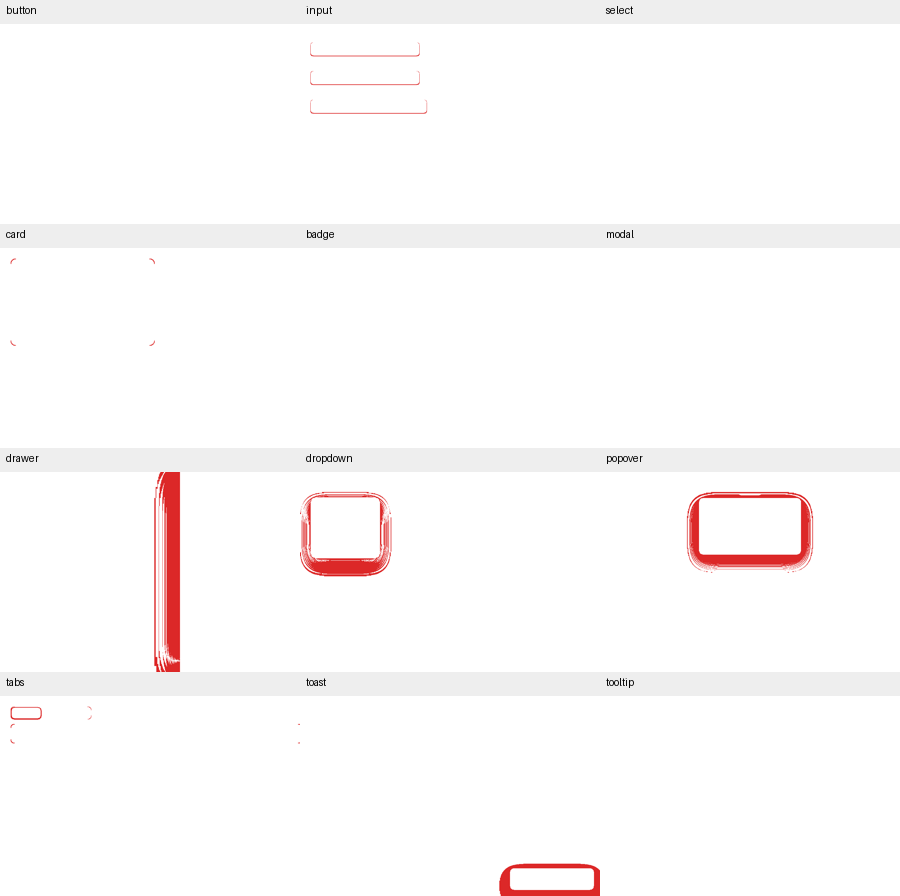
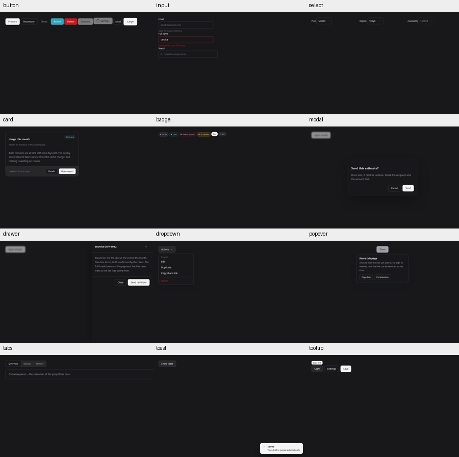
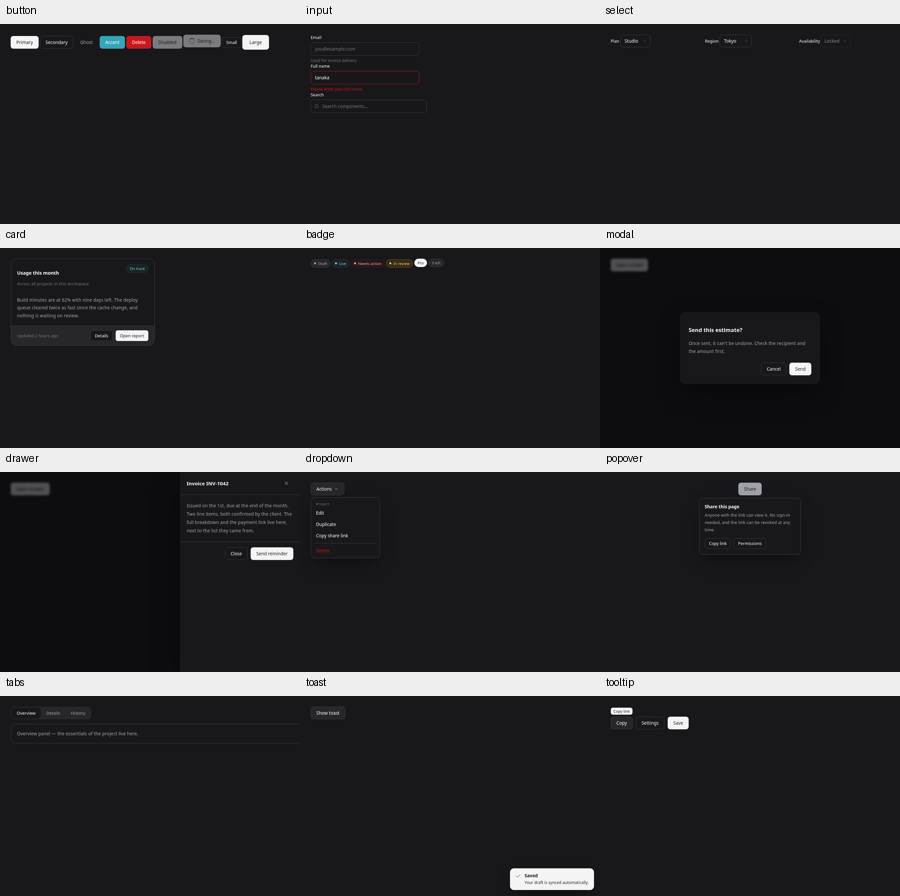
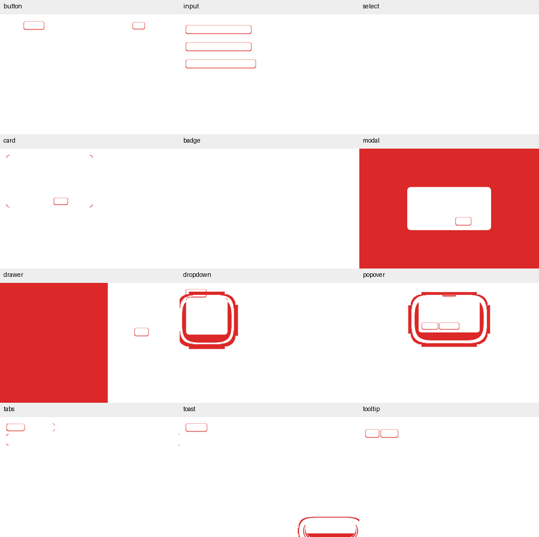
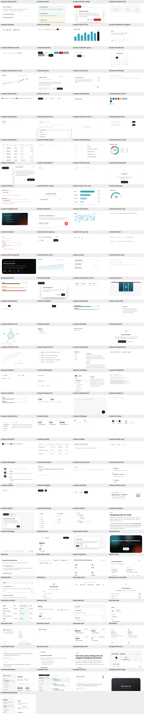
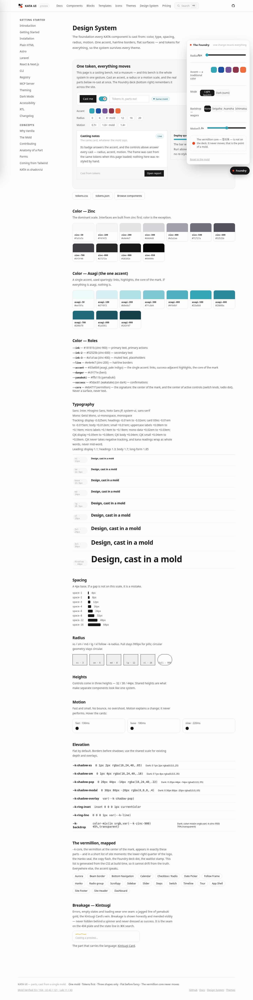
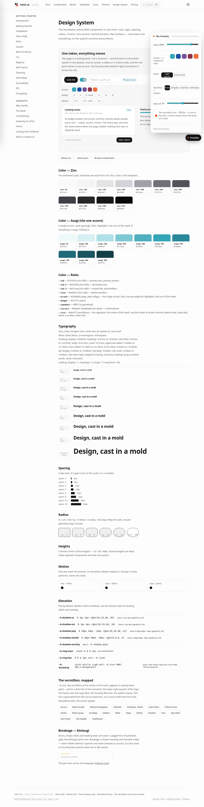

# Shared shape / elevation migration review

**Historical initial PR #19 snapshot.** Lab shadow normalization and ring assignments below are superseded by [the regression correction](../shape-regressions/README.md).

Baseline: `9efb97d059d8820a6d56de8d9c34a041926ed949` (main after PR #18). After: worktree in this PR.
Browser plugin not available; Python Playwright/Chromium used. Desktop 900×600, mobile 360×760, DPR 1, reduced motion. External resources on the generated Foundry page are disabled for deterministic capture.

## Reproduce

```sh
python3 -m tools.sync_shape_tokens --check
python3 -W error::SyntaxWarning build.py
python3 tools/capture_shape_migration.py --before-ref 9efb97d059d8820a6d56de8d9c34a041926ed949
```

Actual source previews and dependencies are loaded. Dialog, drawer, dropdown, popover, toast and tooltip are opened; Tabs is switched and restored. Popover is centered by the common test stage to avoid clipping its unchanged placement algorithm. Each before/after pair uses exactly the same stage. PNG differences count any changed RGB channel; rectangles in verification.json are [x,y,width,height]. No pixel tolerance masks are used.

## Audit result

**29 / 164 → 53 / 164**; UI 42 / 121; Lab 11 / 43.

| Check kind | Before | After |
|---|---:|---:|
| radius | 157 | 0 |
| radius-full | 11 | 0 |
| shadow | 37 | 0 |
| shadow-ring | 12 | 0 |
| duration | 107 | 107 |
| color | 23 | 19 |
| easing | 10 | 10 |
| border | 1 | 1 |

217 radius/shadow findings are removed. The only independent paint changes are the four explicitly requested backdrops (color findings 23 → 19). Duration/easing and all other check counts are unchanged. Checker code/configuration and component metadata/JS are unchanged.

## Pixel differences

| Component | Light changed pixels | Dark changed pixels | Radius changes at base 8px |
|---|---:|---:|---|
| button | 0 | 923 | 99px → 999px |
| input | 2281 | 4545 |  |
| select | 0 | 0 |  |
| card | 221 | 648 | 14px → 16px; 99px → 999px |
| badge | 0 | 0 | 99px → 999px |
| modal | 0 | 450023 |  |
| drawer | 30883 | 324431 |  |
| dropdown | 17665 | 29376 | 11px → 12px; 7px → 8px |
| popover | 24863 | 35828 |  |
| tabs | 885 | 662 | 10px → 12px |
| toast | 11847 | 7415 |  |
| tooltip | 0 | 920 |  |

No preview element rectangle changed. Radius parameter changes can produce zero raster changes: a 99px radius was already clipped to a pill, so 999px looks identical. Shadow offsets/blur/spread and opacity changes are fully listed in the element tables below.

### Overviews

| Theme | Before | After | Pixel difference |
|---|---|---|---|
| Light |  |  |  |
| Dark |  |  |  |

## Dark contrast

The WCAG relative-luminance function is reused from `tools/capture_toast_tokens.py`. Playwright reads computed text/placeholder/pseudo-element colors and ancestor backgrounds. Alpha/opacity are composited over the actual ancestor surfaces before the calculation. Solid surfaces are measured; this is not a pixel OCR or all-state accessibility audit. All currently visible text is included, including inactive buttons and placeholders. Their threshold list is intentionally not fixed here.

| Component | Minimum dark contrast | Below 4.5:1 (including disabled) |
|---|---:|---:|
| button | 2.88:1 | 3 |
| input | 3.06:1 | 4 |
| select | 4.88:1 | 0 |
| card | 3.08:1 | 2 |
| badge | 5.81:1 | 0 |
| modal | 6.91:1 | 0 |
| drawer | 6.91:1 | 0 |
| dropdown | 3.06:1 | 2 |
| popover | 6.91:1 | 0 |
| tabs | 5.81:1 | 0 |
| toast | 13.55:1 | 0 |
| tooltip | 13.55:1 | 0 |

| Component / element | Text | Contrast | State |
|---|---|---:|---|
| button: `button.btn btn-accent btn-md` | Accent | 2.88:1 | text |
| button: `button.btn btn-pri btn-md` | Disabled | 4.19:1 | Disabled (WCAG inactive-control exemption) |
| button: `button.btn btn-pri btn-md` | Saving… | 4.19:1 | Disabled (WCAG inactive-control exemption) |
| input: `input.input` | you@example.com | 3.67:1 | placeholder |
| input: `span.hint` | Used for invoice delivery | 3.67:1 | text |
| input: `span.err` | Please enter your full name | 3.06:1 | text |
| input: `input.input` | Search components… | 3.67:1 | placeholder |
| card: `p.` | Across all projects in this workspace. | 3.67:1 | text |
| card: `div.k-card-f` | Updated 2 hours ago | 3.08:1 | text |
| dropdown: `span.mh` | Project | 3.67:1 | text |
| dropdown: `a.danger` | Delete | 3.06:1 | text |

The disabled-button entries are listed for the requested numerical threshold; WCAG exempts inactive controls. Contrast corrections are deferred to the next PR. Toast body/subtext retain 16.12:1 / 13.55:1.

## Foundry and every UI target

Rendered all 121 UI-profile components/blocks/templates at base radius 0 and 16px. 101 targets have rendered scalable corners. The remaining 20 have only circles/full radii or no rounded surfaces; this is not a failed scale claim. Lab geometry is excluded.

| Base | xs | sm | md | lg | xl | full |
|---|---|---|---|---|---|
| 0px | 0px | 0px | 0px | 0px | 0px | 999px |
| 16px | 6px | 12px | 16px | 24px | 32px | 999px |

The actual built Foundry slider was changed, the page reloaded, and all six token values asserted. Saved zero survives reload. Full stays fixed at 999px and percentages remain circular, as required by the scale contract.

| Radius 0 | Radius 16 |
|---|---|
|  |  |
|  |  |

Targets with no scalable rendered radius: `components/avatar`, `components/badge`, `components/breadcrumbs`, `components/candlestick-chart`, `components/chip`, `components/gauge`, `components/line-chart`, `components/meter`, `components/progress`, `components/radar-chart`, `components/radio`, `components/rating`, `components/scatter-chart`, `components/separator`, `components/slider`, `components/sparkline`, `components/stat`, `components/switch`, `components/timeline`, `blocks/logo-cloud`.

## Nearest shadow mappings

Dialog-family/overlay roles choose modal/pop first; unassigned decorative effects choose the closest four-number geometry (offset-x, offset-y, blur, spread) by squared distance to the four shared stages. Old artistic glow colors/offsets can change substantially because the four-stage constraint is deliberate. This ledger does not hide those changes. Inset uses the shared inset ring; thin separators use the shared line ring; other focus-like rings use the existing --k-ring.

| Observed shadow | Shared replacement | Targets |
|---|---|---|
| `-24px 0 60px -24px rgba(0,0,0,.35)` | `var(--k-shadow-modal)` | `components/drawer` |
| `0 0 0 1px rgba(24,24,27,.25)` | `var(--k-ring-line)` | `components/comparison-slider` |
| `0 0 0 1px var(--k-line)` | `var(--k-ring-line)` | `templates/product-page` |
| `0 0 0 2px var(--k-accent)` | `var(--k-ring)` | `templates/product-page` |
| `0 0 0 2px var(--k-bg),0 0 0 4px var(--k-accent)` | `var(--k-ring)` | `components/color-picker` |
| `0 0 0 2px var(--k-ink)` | `var(--k-ring)` | `templates/product-page` |
| `0 0 0 3px var(--k-accent-bg)` | `var(--k-ring)` | `components/input-otp`, `components/tag-input` |
| `0 0 0 4px var(--k-accent-bg)` | `var(--k-ring)` | `components/tracing-beam` |
| `0 0 0 5px var(--k-accent-bg-strong)` | `var(--k-ring)` | `components/tour` |
| `0 0 10px 2px rgba(255,255,255,.3)` | `var(--k-shadow-sm)` | `components/meteors` |
| `0 0 18px -4px var(--k-accent-bg)` | `var(--k-shadow-sm)` | `components/glow-button` |
| `0 0 26px -6px var(--k-accent)` | `var(--k-shadow-sm)` | `components/glow-button` |
| `0 0 46px color-mix(in srgb,var(--k-accent) 45%,transparent)` | `var(--k-shadow-pop)` | `components/converge` |
| `0 12px 26px -10px rgba(16,24,40,.4)` | `var(--k-shadow-pop)` | `components/orbit` |
| `0 14px 28px -14px rgba(16,24,40,.28)` | `var(--k-shadow-pop)` | `components/torn-ticket` |
| `0 14px 34px -12px rgba(16,24,40,.25)` | `var(--k-shadow-pop)` | `blocks/cookie-consent` |
| `0 16px 40px -12px rgba(16,24,40,.18)` | `var(--k-shadow-pop)` | `components/hover-card` |
| `0 16px 40px -14px rgba(16,24,40,.25)` | `var(--k-shadow-pop)` | `components/dropdown` |
| `0 18px 40px -12px rgba(16,24,40,.25)` | `var(--k-shadow-pop)` | `components/menubar` |
| `0 18px 40px -18px rgba(0,0,0,.45)` | `var(--k-shadow-pop)` | `components/glass-panel` |
| `0 18px 44px -14px rgba(16,24,40,.28)` | `var(--k-shadow-pop)` | `components/tour` |
| `0 1px 2px rgba(16,24,40,.04)` | `var(--k-shadow-xs)` | `components/input` |
| `0 1px 2px rgba(16,24,40,.05)` | `var(--k-shadow-xs)` | `blocks/kanban`, `components/button` |
| `0 1px 2px rgba(16,24,40,.09)` | `var(--k-shadow-xs)` | `components/segmented` |
| `0 1px 2px rgba(16,24,40,.18)` | `var(--k-shadow-xs)` | `components/slider` |
| `0 1px 3px rgba(0,0,0,.3),inset 0 0 0 1px rgba(0,0,0,.08)` | `var(--k-shadow-xs),var(--k-ring-inset)` | `components/switch` |
| `0 1px 3px rgba(16,24,40,.14)` | `var(--k-shadow-xs)` | `components/tabs` |
| `0 1px 4px rgba(16,24,40,.18)` | `var(--k-shadow-sm)` | `components/dual-range` |
| `0 20px 44px -12px rgba(16,24,40,.28)` | `var(--k-shadow-pop)` | `components/context-menu` |
| `0 20px 44px -14px rgba(0,0,0,.45)` | `var(--k-shadow-pop)` | `components/toast` |
| `0 20px 44px -14px rgba(16,24,40,.22)` | `var(--k-shadow-pop)` | `components/cascader`, `components/date-picker`, `components/navigation-menu`, `components/time-picker` |
| `0 2px 10px rgba(16,24,40,.3)` | `var(--k-shadow-sm)` | `components/comparison-slider` |
| `0 2px 8px rgba(16,24,40,.08)` | `var(--k-shadow-sm)` | `components/speed-dial` |
| `0 2px 8px rgba(16,24,40,.1)` | `var(--k-shadow-sm)` | `components/speed-dial` |
| `0 30px 80px -20px rgba(0,0,0,.4)` | `var(--k-shadow-modal)` | `components/alert-dialog`, `components/modal` |
| `0 30px 80px -20px rgba(0,0,0,.45)` | `var(--k-shadow-modal)` | `components/command` |
| `0 3px 7px rgba(16,24,40,.25)` | `var(--k-shadow-sm)` | `components/newtons-cradle` |
| `0 4px 12px rgba(16,24,40,.1)` | `var(--k-shadow-sm)` | `components/orbit` |
| `0 6px 18px rgba(16,24,40,.28)` | `var(--k-shadow-sm)` | `components/speed-dial` |
| `inset 0 0 0 1px currentColor` | `var(--k-ring-inset)` | `components/button` |

## Remaining risks

- No manual screen-reader or Firefox/Safari verification. Native Select popup rendering was not compared.
- The contrast list covers visible default/open/hover states in these previews, not every combination of focus/active/invalid states.
- At 360px, Input remains 376px scroll width and Tabs 366px both before and after; these existing 16px/6px overflow issues are not changed by this shape migration.
- Lab glow/effect shadows are normalized and can visibly lose their colored glow; geometry and duration remain unchanged. Review the mapping ledger before merging.
- All-UI galleries render source HTML/CSS without running every component script; native dialogs are exposed for shape inspection. They are shape evidence, not 121-component interaction certification.

## Exact element changes

### button

light: 0 changed pixels; difference bounds None.

| Element | Changed property | Before | After |
|---|---|---|---|
| `span.spin` | `radius` | `['99px', '99px', '99px', '99px']` | `['999px', '999px', '999px', '999px']` |

dark: 923 changed pixels; difference bounds [118, 35, 726, 77].

| Element | Changed property | Before | After |
|---|---|---|---|
| `button.btn btn-sec btn-md` | `shadow` | `rgba(16, 24, 40, 0.05) 0px 1px 2px 0px` | `rgba(0, 0, 0, 0.25) 0px 1px 2px 0px` |
| `span.spin` | `radius` | `['99px', '99px', '99px', '99px']` | `['999px', '999px', '999px', '999px']` |
| `button.btn btn-sec btn-sm` | `shadow` | `rgba(16, 24, 40, 0.05) 0px 1px 2px 0px` | `rgba(0, 0, 0, 0.25) 0px 1px 2px 0px` |

### input

light: 2281 changed pixels; difference bounds [31, 55, 381, 269].

| Element | Changed property | Before | After |
|---|---|---|---|
| `input.input` | `shadow` | `rgba(16, 24, 40, 0.04) 0px 1px 2px 0px` | `rgba(16, 24, 40, 0.05) 0px 1px 2px 0px` |
| `input.input errb` | `shadow` | `rgba(16, 24, 40, 0.04) 0px 1px 2px 0px` | `rgba(16, 24, 40, 0.05) 0px 1px 2px 0px` |

dark: 4545 changed pixels; difference bounds [30, 54, 382, 270].

| Element | Changed property | Before | After |
|---|---|---|---|
| `input.input` | `shadow` | `rgba(16, 24, 40, 0.04) 0px 1px 2px 0px` | `rgba(0, 0, 0, 0.25) 0px 1px 2px 0px` |
| `input.input errb` | `shadow` | `rgba(16, 24, 40, 0.04) 0px 1px 2px 0px` | `rgba(0, 0, 0, 0.25) 0px 1px 2px 0px` |

### select

light: 0 changed pixels; difference bounds None.

| Element | Changed property | Before | After |
|---|---|---|---|

dark: 0 changed pixels; difference bounds None.

| Element | Changed property | Before | After |
|---|---|---|---|

### card

light: 221 changed pixels; difference bounds [32, 32, 464, 293].

| Element | Changed property | Before | After |
|---|---|---|---|
| `div.k-card` | `radius` | `['14px', '14px', '14px', '14px']` | `['16px', '16px', '16px', '16px']` |
| `span.badge asagi` | `radius` | `['99px', '99px', '99px', '99px']` | `['999px', '999px', '999px', '999px']` |

dark: 648 changed pixels; difference bounds [32, 32, 464, 293].

| Element | Changed property | Before | After |
|---|---|---|---|
| `div.k-card` | `radius` | `['14px', '14px', '14px', '14px']` | `['16px', '16px', '16px', '16px']` |
| `button.btn btn-sec btn-sm` | `shadow` | `rgba(16, 24, 40, 0.05) 0px 1px 2px 0px` | `rgba(0, 0, 0, 0.25) 0px 1px 2px 0px` |
| `span.badge asagi` | `radius` | `['99px', '99px', '99px', '99px']` | `['999px', '999px', '999px', '999px']` |

### badge

light: 0 changed pixels; difference bounds None.

| Element | Changed property | Before | After |
|---|---|---|---|
| `span.badge` | `radius` | `['99px', '99px', '99px', '99px']` | `['999px', '999px', '999px', '999px']` |
| `span.badge asagi` | `radius` | `['99px', '99px', '99px', '99px']` | `['999px', '999px', '999px', '999px']` |
| `span.badge red` | `radius` | `['99px', '99px', '99px', '99px']` | `['999px', '999px', '999px', '999px']` |
| `span.badge yamabuki` | `radius` | `['99px', '99px', '99px', '99px']` | `['999px', '999px', '999px', '999px']` |
| `span.badge dark` | `radius` | `['99px', '99px', '99px', '99px']` | `['999px', '999px', '999px', '999px']` |

dark: 0 changed pixels; difference bounds None.

| Element | Changed property | Before | After |
|---|---|---|---|
| `span.badge` | `radius` | `['99px', '99px', '99px', '99px']` | `['999px', '999px', '999px', '999px']` |
| `span.badge asagi` | `radius` | `['99px', '99px', '99px', '99px']` | `['999px', '999px', '999px', '999px']` |
| `span.badge red` | `radius` | `['99px', '99px', '99px', '99px']` | `['999px', '999px', '999px', '999px']` |
| `span.badge yamabuki` | `radius` | `['99px', '99px', '99px', '99px']` | `['999px', '999px', '999px', '999px']` |
| `span.badge dark` | `radius` | `['99px', '99px', '99px', '99px']` | `['999px', '999px', '999px', '999px']` |

### modal

light: 0 changed pixels; difference bounds None.

| Element | Changed property | Before | After |
|---|---|---|---|
| `dialog.kmodal::backdrop` | `background` | `rgba(24, 24, 27, 0.45)` | `color(srgb 0.0941176 0.0941176 0.105882 / 0.45)` |

dark: 450023 changed pixels; difference bounds [0, 0, 900, 600].

| Element | Changed property | Before | After |
|---|---|---|---|
| `dialog.kmodal` | `shadow` | `rgba(0, 0, 0, 0.4) 0px 30px 80px -20px` | `rgba(0, 0, 0, 0.65) 0px 30px 80px -20px` |
| `dialog.kmodal::backdrop` | `background` | `rgba(24, 24, 27, 0.45)` | `color(srgb 0.0352941 0.0352941 0.0431373 / 0.7)` |
| `button.btn btn-sec btn-md` | `shadow` | `rgba(16, 24, 40, 0.05) 0px 1px 2px 0px` | `rgba(0, 0, 0, 0.25) 0px 1px 2px 0px` |

### drawer

light: 30883 changed pixels; difference bounds [463, 0, 540, 600].

| Element | Changed property | Before | After |
|---|---|---|---|
| `dialog.kdrawer` | `shadow` | `rgba(0, 0, 0, 0.35) -24px 0px 60px -24px` | `rgba(0, 0, 0, 0.4) 0px 30px 80px -20px` |
| `dialog.kdrawer::backdrop` | `background` | `rgba(24, 24, 27, 0.45)` | `color(srgb 0.0941176 0.0941176 0.105882 / 0.45)` |

dark: 324431 changed pixels; difference bounds [0, 0, 745, 600].

| Element | Changed property | Before | After |
|---|---|---|---|
| `dialog.kdrawer` | `shadow` | `rgba(0, 0, 0, 0.35) -24px 0px 60px -24px` | `rgba(0, 0, 0, 0.65) 0px 30px 80px -20px` |
| `dialog.kdrawer::backdrop` | `background` | `rgba(24, 24, 27, 0.45)` | `color(srgb 0.0352941 0.0352941 0.0431373 / 0.7)` |
| `button.btn btn-sec btn-md` | `shadow` | `rgba(16, 24, 40, 0.05) 0px 1px 2px 0px` | `rgba(0, 0, 0, 0.25) 0px 1px 2px 0px` |

### dropdown

light: 17665 changed pixels; difference bounds [0, 60, 274, 313].

| Element | Changed property | Before | After |
|---|---|---|---|
| `a.danger` | `radius` | `['7px', '7px', '7px', '7px']` | `['8px', '8px', '8px', '8px']` |
| `span.menu open` | `radius` | `['11px', '11px', '11px', '11px']` | `['12px', '12px', '12px', '12px']` |
| `span.menu open` | `shadow` | `rgba(16, 24, 40, 0.25) 0px 16px 40px -14px` | `rgba(16, 24, 40, 0.22) 0px 20px 44px -14px` |
| `a.` | `radius` | `['7px', '7px', '7px', '7px']` | `['8px', '8px', '8px', '8px']` |

dark: 29376 changed pixels; difference bounds [0, 31, 292, 331].

| Element | Changed property | Before | After |
|---|---|---|---|
| `a.danger` | `radius` | `['7px', '7px', '7px', '7px']` | `['8px', '8px', '8px', '8px']` |
| `button.btn btn-sec btn-md` | `shadow` | `rgba(16, 24, 40, 0.05) 0px 1px 2px 0px` | `rgba(0, 0, 0, 0.25) 0px 1px 2px 0px` |
| `span.menu open` | `radius` | `['11px', '11px', '11px', '11px']` | `['12px', '12px', '12px', '12px']` |
| `span.menu open` | `shadow` | `rgba(16, 24, 40, 0.25) 0px 16px 40px -14px` | `rgba(0, 0, 0, 0.55) 0px 20px 44px -14px` |
| `a.` | `radius` | `['7px', '7px', '7px', '7px']` | `['8px', '8px', '8px', '8px']` |

### popover

light: 24863 changed pixels; difference bounds [261, 60, 639, 302].

| Element | Changed property | Before | After |
|---|---|---|---|
| `div.kpop open` | `shadow` | `rgba(16, 24, 40, 0.28) 0px 18px 44px -14px` | `rgba(16, 24, 40, 0.22) 0px 20px 44px -14px` |

dark: 35828 changed pixels; difference bounds [245, 46, 655, 320].

| Element | Changed property | Before | After |
|---|---|---|---|
| `div.kpop open` | `shadow` | `rgba(16, 24, 40, 0.28) 0px 18px 44px -14px` | `rgba(0, 0, 0, 0.55) 0px 20px 44px -14px` |
| `button.btn btn-sec btn-sm` | `shadow` | `rgba(16, 24, 40, 0.05) 0px 1px 2px 0px` | `rgba(0, 0, 0, 0.25) 0px 1px 2px 0px` |

### tabs

light: 885 changed pixels; difference bounds [32, 32, 900, 142].

| Element | Changed property | Before | After |
|---|---|---|---|
| `span.tabs` | `radius` | `['10px', '10px', '10px', '10px']` | `['12px', '12px', '12px', '12px']` |
| `span.thumb` | `shadow` | `rgba(16, 24, 40, 0.14) 0px 1px 3px 0px` | `rgba(16, 24, 40, 0.05) 0px 1px 2px 0px` |
| `div.tabpane` | `radius` | `['10px', '10px', '10px', '10px']` | `['12px', '12px', '12px', '12px']` |

dark: 662 changed pixels; difference bounds [32, 32, 900, 142].

| Element | Changed property | Before | After |
|---|---|---|---|
| `span.tabs` | `radius` | `['10px', '10px', '10px', '10px']` | `['12px', '12px', '12px', '12px']` |
| `span.thumb` | `shadow` | `rgba(16, 24, 40, 0.14) 0px 1px 3px 0px` | `rgba(0, 0, 0, 0.25) 0px 1px 2px 0px` |
| `div.tabpane` | `radius` | `['10px', '10px', '10px', '10px']` | `['12px', '12px', '12px', '12px']` |

### toast

light: 11847 changed pixels; difference bounds [598, 503, 900, 600].

| Element | Changed property | Before | After |
|---|---|---|---|
| `div.toast` | `shadow` | `rgba(0, 0, 0, 0.45) 0px 20px 44px -14px` | `rgba(16, 24, 40, 0.22) 0px 20px 44px -14px` |

dark: 7415 changed pixels; difference bounds [30, 31, 900, 600].

| Element | Changed property | Before | After |
|---|---|---|---|
| `button.btn btn-sec btn-md` | `shadow` | `rgba(16, 24, 40, 0.05) 0px 1px 2px 0px` | `rgba(0, 0, 0, 0.25) 0px 1px 2px 0px` |
| `div.toast` | `shadow` | `rgba(0, 0, 0, 0.45) 0px 20px 44px -14px` | `rgba(0, 0, 0, 0.55) 0px 20px 44px -14px` |

### tooltip

light: 0 changed pixels; difference bounds None.

| Element | Changed property | Before | After |
|---|---|---|---|

dark: 920 changed pixels; difference bounds [30, 61, 195, 103].

| Element | Changed property | Before | After |
|---|---|---|---|
| `button.btn btn-sec btn-md k-tip` | `shadow` | `rgba(16, 24, 40, 0.05) 0px 1px 2px 0px` | `rgba(0, 0, 0, 0.25) 0px 1px 2px 0px` |
