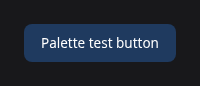
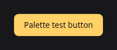
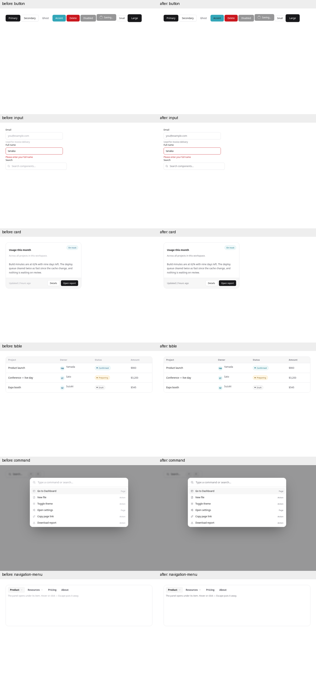
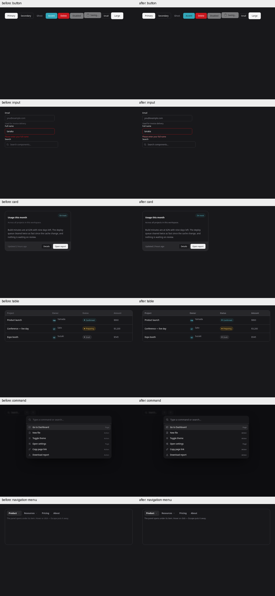

# Shared text contrast — PR #20

Approved role separation is applied. Default accent remains #33a6b8; core #eb471f and dark canvas #18181b are unchanged. Checker rules are unchanged: Mold Verified **53 / 164**, UI **42 / 121**, Lab **11 / 43**. Baseline identities are unchanged.

## Token roles

| Token | Light | Dark | Role |
|---|---|---|---|
| --k-ink-3 | #71717a | #90909a | Muted text, hints and placeholders |
| --k-yamabuki-ink | #876019 | #f6c555 (unchanged) | Text on yellow tint |
| --k-danger-ink | #b7282e (unchanged) | #f28b90 | Danger text on bg / bg-soft |
| --k-on-accent | var(--k-ink) fallback; adaptive relative color | same | Text on full accent surfaces |
| --k-accent-ink | #165e83 fallback; OKLCH L ≤ .48 | #81c7d4 fallback; OKLCH L ≥ .78 | Accent foreground on neutral surfaces |
| --k-accent-hover | 90% accent + 10% contrast surface | same | Hover surface moves away from chosen text |
| --k-accent-contrast-surface | var(--k-bg) fallback; adaptive white/black | same | Hover companion surface |
| --k-accent-luminance | relative linear-sRGB WCAG luminance carrier | same | Internal generated color math; no component API |
| --k-on-color | #fff (unchanged) | #fff (unchanged) | Strong danger and fixed dark Lab surfaces |

Only the light ink-3 and yellow-ink values change from main: their previous values failed 4.5:1 on neutral surfaces (ink-3: 2.56 on white / 2.39 on bg-soft; yellow-ink: 4.20 on its preview tint). Danger-ink light is retained. The accent default hue and luminance are retained in both modes. Danger fill remains the existing strong surface with white text. Danger hover uses the existing thin danger-bg surface with danger-ink; active restores strong danger + white explicitly. Accent hover no longer misuses accent-ink as a fill.

The relative-color block is gated by `@supports (color: oklch(from red l c h))`. A neutral linear-sRGB carrier computes Y = .2126 R + .7152 G + .0722 B exactly; OKLCH L alone cannot express WCAG Y=.179 for all hues. Below Y=.179, on-accent is white; above it, it uses ink-like channels, darkened near the crossover to retain 4.6:1 headroom. Foreground accent-ink retains hue/chroma and clamps OKLCH lightness. Static exports use the smallest sRGB black/white mix satisfying both neutral surfaces. This is shared role math, not component-specific paint.

| Danger foreground | On bg | On bg-soft |
|---|---:|---:|
| light #b7282e | 6.26 | 5.84 |
| dark #f28b90 | 7.48 | 6.29 |

## 40 parts × two themes

Each cell is the minimum eligible rendered text contrast in the default/open preview. Disabled controls and their associated labels are exempt; their measured minimum is listed separately. All normal text uses 4.5:1, including placeholders.

| Part | Light before → after | Dark before → after | Disabled minimum (light / dark, after) |
|---|---:|---:|---:|
| button | 2.88 → 5.79 | 2.88 → 5.79 | 2.92 / 4.19 |
| input | 2.56 → 4.83 | 3.06 → 5.60 | — / — |
| select | 17.72 → 17.72 | 16.12 → 16.12 | 3.38 / 4.88 |
| card | 2.39 → 4.51 | 3.08 → 4.71 | — / — |
| badge | 4.20 → 5.26 | 5.81 → 5.81 | — / — |
| modal | 7.73 → 7.73 | 6.91 → 6.91 | — / — |
| drawer | 7.73 → 7.73 | 6.91 → 6.91 | — / — |
| dropdown | 2.56 → 4.83 | 3.06 → 5.60 | — / — |
| popover | 7.73 → 7.73 | 6.91 → 6.91 | — / — |
| tabs | 6.55 → 6.55 | 5.81 → 5.81 | — / — |
| toast | 16.54 → 16.54 | 13.55 → 13.55 | — / — |
| tooltip | 16.54 → 16.54 | 13.55 → 13.55 | — / — |
| field | 2.56 → 4.83 | 3.06 → 5.60 | — / — |
| textarea | 2.56 → 4.83 | 3.67 → 5.60 | — / — |
| checkbox | 17.72 → 17.72 | 16.12 → 16.12 | — / — |
| radio | 7.09 → 6.10 | 9.33 → 9.16 | 4.83 / 5.60 |
| switch | 17.72 → 17.72 | 16.12 → 16.12 | — / — |
| accordion | 7.73 → 7.73 | 6.91 → 6.91 | — / — |
| alert | 7.08 → 7.08 | 5.43 → 5.43 | — / — |
| table | 2.39 → 4.51 | 3.08 → 4.71 | — / — |
| pagination | 2.56 → 4.83 | 3.67 → 5.60 | — / — |
| breadcrumbs | 7.73 → 7.73 | 6.91 → 6.91 | — / — |
| combobox | 17.72 → 17.72 | 16.12 → 16.12 | — / — |
| input-otp | 17.72 → 17.72 | 16.12 → 16.12 | — / — |
| tag-input | 2.56 → 4.83 | 3.67 → 5.60 | — / — |
| file-upload | 2.56 → 4.83 | 3.67 → 5.60 | — / — |
| slider | 7.73 → 7.73 | 6.91 → 6.91 | — / — |
| dual-range | 2.56 → 4.83 | 3.67 → 5.60 | — / — |
| segmented | 6.55 → 6.55 | 5.81 → 5.81 | — / — |
| toggle | 7.73 → 7.73 | 6.91 → 6.91 | — / — |
| button-group | 17.72 → 17.72 | 16.12 → 16.12 | — / — |
| input-group | 7.22 → 7.22 | 5.81 → 5.81 | — / — |
| alert-dialog | 5.79 → 5.79 | 5.79 → 5.79 | — / — |
| command | 2.39 → 4.51 | 3.08 → 4.71 | — / — |
| context-menu | 2.56 → 4.83 | 3.06 → 5.60 | — / — |
| hover-card | 2.88 → 6.09 | 6.09 → 6.09 | — / — |
| navigation-menu | 2.56 → 4.83 | 3.67 → 5.60 | — / — |
| menubar | 2.56 → 4.83 | 3.67 → 5.60 | — / — |
| copy-field | 7.73 → 7.73 | 6.91 → 6.91 | — / — |
| collapsible | 7.73 → 7.73 | 6.91 → 6.91 | — / — |

light: 247 eligible text samples, 0 below 4.5:1.

dark: 247 eligible text samples, 0 below 4.5:1.

## Hover / active / focus

Values are scoped to the interacted element and its descendants, including hints. Actual mouse-down is used for :active; keyboard focus is used for :focus-visible. Menus are reopened between states.

| Part / target / state | Light before → after | Dark before → after |
|---|---:|---:|
| button `.btn-accent / hover` | 7.09 → 6.88 | 1.90 → 6.88 |
| button `.btn-accent / active` | 2.88 → 6.15 | 2.88 → 6.15 |
| button `.btn-accent / focus` | 2.88 → 6.15 | 2.88 → 6.15 |
| button `.btn-danger / hover` | 6.26 → 5.57 | 2.14 → 7.24 |
| button `.btn-danger / active` | 5.79 → 5.79 | 5.79 → 5.79 |
| button `.btn-danger / focus` | 5.79 → 5.79 | 5.79 → 5.79 |
| dropdown `.menu a:not(.danger) / hover` | 16.54 → 16.54 | 13.55 → 13.55 |
| dropdown `.menu a:not(.danger) / active` | 16.54 → 16.54 | 13.55 → 13.55 |
| dropdown `.menu a:not(.danger) / focus` | 17.72 → 17.72 | 16.12 → 16.12 |
| dropdown `.menu a.danger / hover` | 5.41 → 5.84 | 2.57 → 6.29 |
| dropdown `.menu a.danger / active` | 5.41 → 5.84 | 2.57 → 6.29 |
| dropdown `.menu a.danger / focus` | 5.79 → 6.26 | 3.06 → 7.48 |
| context-menu `.k-ctx button:not(.danger) / hover` | 2.39 → 4.51 | 3.08 → 4.71 |
| context-menu `.k-ctx button:not(.danger) / active` | 2.39 → 4.51 | 3.08 → 4.71 |
| context-menu `.k-ctx button:not(.danger) / focus` | 2.39 → 4.51 | 3.08 → 4.71 |
| context-menu `.k-ctx button.danger / hover` | 2.39 → 4.51 | 2.57 → 4.71 |
| context-menu `.k-ctx button.danger / active` | 2.39 → 4.51 | 2.57 → 4.71 |
| context-menu `.k-ctx button.danger / focus` | 2.39 → 4.51 | 2.57 → 4.71 |
| tabs `.tabs button.on / hover` | 15.02 → 15.02 | 13.55 → 13.55 |
| tabs `.tabs button.on / active` | 15.02 → 15.02 | 13.55 → 13.55 |
| tabs `.tabs button.on / focus` | 15.02 → 15.02 | 13.55 → 13.55 |
| tabs `.tabs button:not(.on) / hover` | 6.55 → 6.55 | 5.81 → 5.81 |
| tabs `.tabs button:not(.on) / active` | 6.55 → 6.55 | 5.81 → 5.81 |
| tabs `.tabs button:not(.on) / focus` | 6.55 → 6.55 | 5.81 → 5.81 |
| pagination `a.k-page[aria-current="page"] / hover` | 16.54 → 16.54 | 13.55 → 13.55 |
| pagination `a.k-page[aria-current="page"] / active` | 16.54 → 16.54 | 13.55 → 13.55 |
| pagination `a.k-page[aria-current="page"] / focus` | 17.72 → 17.72 | 16.12 → 16.12 |
| pagination `a.k-page:not([aria-current]):not(.disabled) / hover` | 16.54 → 16.54 | 13.55 → 13.55 |
| pagination `a.k-page:not([aria-current]):not(.disabled) / active` | 16.54 → 16.54 | 13.55 → 13.55 |
| pagination `a.k-page:not([aria-current]):not(.disabled) / focus` | 7.73 → 7.73 | 6.91 → 6.91 |

## Foundry custom colors

| Mode | Accent | Text | Default | Hover | Active | Focus |
|---|---|---|---:|---:|---:|---:|
| light | #1f3a5f | white | 11.48 | 12.56 | 11.48 | 11.48 |
| light | #ffd166 | #18181b | 12.29 | 12.76 | 12.29 | 12.29 |
| dark | #1f3a5f | white | 11.48 | 12.56 | 11.48 | 11.48 |
| dark | #ffd166 | #18181b | 12.29 | 12.76 | 12.29 | 12.29 |

The same four palette/theme combinations pass when (a) editing --k-accent directly without Foundry JS, and (b) loading downloaded CSS after removing the entire relative-color block. Browser exports match Python-generated preset exports byte-for-byte. Themes custom color exports use the same function. The legacy Foundry runtime calculates static roles when relative colors are unsupported; plain CSS retains the requested static var(--k-ink) fallback, so unsupported browsers editing CSS manually must use the exported static theme.




## Replacements

The approved nine-file patch is applied, then refined by decisions B–F. No component-specific color literal or token is added.

| File | Old → new |
|---|---|
| blocks/faq/faq.css | accent foreground → accent-ink |
| blocks/integrations/integrations.css | accent foreground → accent-ink |
| blocks/testimonials/testimonials.css | accent foreground → accent-ink |
| blocks/use-cases/use-cases.css | accent foreground → accent-ink |
| components/bar-chart/bar-chart.css | full accent surface text → on-accent |
| components/burst-button/burst-button.css | full accent surface text → on-accent |
| components/button/button.css | full accent surface text → on-accent; danger-ink hover fill → danger-bg + danger-ink; accent-ink hover fill → accent-hover + on-accent; active roles explicit |
| components/card/examples.html | accent foreground → accent-ink |
| components/chip/chip.css | danger foreground → danger-ink |
| components/combobox/combobox.css | accent foreground → accent-ink |
| components/context-menu/context-menu.css | danger foreground → danger-ink |
| components/copy-field/copy-field.css | full accent surface text → on-accent |
| components/dropdown/dropdown.css | danger foreground → danger-ink |
| components/dual-range/dual-range.css | full accent surface text → on-accent |
| components/field/field.css | danger foreground → danger-ink |
| components/file-upload/file-upload.css | danger foreground → danger-ink |
| components/funnel-chart/funnel-chart.css | full accent surface text → on-accent |
| components/goo-cursor/goo-cursor.css | full accent surface text → on-accent |
| components/gravity-playground/gravity-playground.css | full accent surface text → on-accent |
| components/heatmap/heatmap.css | full accent surface text → on-accent |
| components/hover-card/hover-card.css | accent foreground → accent-ink |
| components/input/input.css | danger foreground → danger-ink |
| components/jelly-buttons/jelly-buttons.css | full accent surface text → on-accent |
| components/liquid-button/liquid-button.css | full accent surface text → on-accent |
| components/progress/progress.css | full accent surface text → on-accent |
| components/rating/rating.css | accent foreground → accent-ink |
| components/split-panel/split-panel.css | accent foreground → accent-ink |
| components/switch/switch.css | full accent surface text → on-accent |
| components/tracing-beam/tracing-beam.css | full accent surface text → on-accent |
| components/tree/tree.css | accent foreground → accent-ink |
| templates/inbox/inbox.css | full accent surface text → on-accent |

`system/tokens.json` owns values, role descriptions and contrast configuration. `tools/sync_shape_tokens.py` and `tools/color_roles.py` generate tokens.css. `build.py` regenerates registry, bundles, llms and design-system metadata; the same event-based helper in `system/color-roles.js` drives Foundry and Themes exports. Existing API names and on-color are preserved.

## Visual evidence

Each row is before / after, ordered Button, Input, Card, Table, Command, Navigation Menu. Full individual PNGs and before.json / after.json are adjacent.




Historical `proposal-*.png`, `proposal.json` and `shared-role-proposal.patch` record the earlier diagnostic discussion; their rejected light-accent darkening is not the implemented result. Use `after.json` and `custom-accents.json` for current measurements.

## Verification and limits

- Chromium 154, real preview CSS/JS, 40 default/open previews × 2 themes; 60 element/state measurements; 24 custom palette/state/export/manual-CSS measurements. No page errors.
- Alpha-composited computed foreground/background colors use the same WCAG calculation as Toast. Non-painted zero-opacity ancestors and non-text input values are excluded. CSS-only `.disabled` does not create an exemption.
- Mold rules unchanged; 53/164, token-values 137; no added token-values finding. Baseline checked without changing identities. 28 unit tests pass; warning-as-error build and template verification pass.
- Not verified: Firefox/Safari relative color behavior, screen readers, all hidden/interactive states beyond those listed, native select popups, and text over gradients/images. This is measured preview coverage, not a whole-library WCAG conformance claim.

Reproduce:
```sh
python3 -m tools.capture_text_contrast --phase before --ref ee7d1796fd8b8deb34340bee7d21eb8d04e59a3a --limit 40
python3 -m tools.capture_text_contrast --phase after --limit 40
python3 -m http.server 8765 --bind 127.0.0.1 --directory dist
python3 -m tools.capture_custom_accents
```
