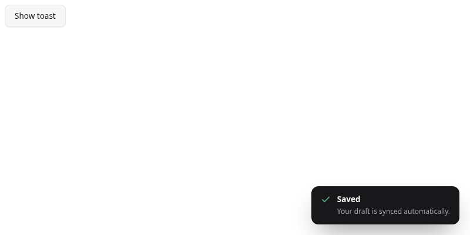
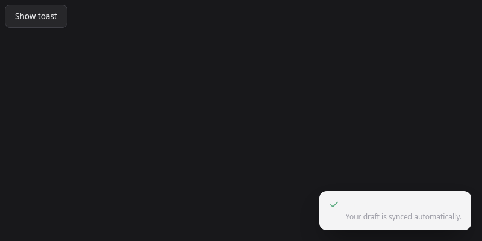

# Toast local-token verification

Run from the repository root:

```sh
python3 tools/capture_toast_tokens.py --before-ref 6140cbfe9a3b2f86eec8053067b148b2e1c1c3b6
```

Requires Python Playwright and Chromium (`--chromium` overrides its executable).
The harness loads the actual Button/Toast sources, clicks Show toast, and captures
an 800×400 viewport in light and dark themes with reduced motion. It asserts
identical PNG hashes and computed text/background/subtext colors and no console
or page errors. See `verification.json` for browser/version and hashes.

| Theme | Before | After |
|---|---|---|
| Light |  |  |
| Dark |  |  |

Both themes are byte-identical before/after. The existing dark Toast has very
poor contrast: text and background both resolve to rgb(244,244,245). This scoped
variable move preserves that existing behavior; it does not establish
accessibility. Manual screen-reader and other-browser checks were not performed.

`audit-summary.json` records the complete checker summaries before/after this
revision. Rule effects count removed findings; reclassified findings remain errors.

## Checker regression verification

The final checker was also verified with:

```sh
python3 -W error::SyntaxWarning -m unittest discover -s tests -p 'test_*.py'
python3 -W error::SyntaxWarning -m tools.verify_template --json /tmp/mold-template.json
python3 -W error::SyntaxWarning build.py
python3 -W error::SyntaxWarning -m tools.mold_publish --check
```

Results: 23 unittest methods passed (176 table-driven policy fixtures included),
the temporary UI template passed every check with zero warnings and was removed,
and the build/publication consistency checks passed. `check.py` returns exit 1
because the catalog still has failing targets: 29/164 pass, with 358 token-value
findings and 132 deduplicated focus findings. This is not a clean-catalog claim.
The committed and trusted-main ratchets both pass; all previous 21 passing
targets remain passing. See `audit-summary.json` for all finding counts.
